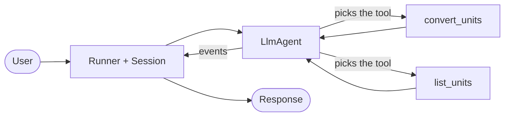

# 01 · Basic agent with tools (Google ADK)

A single agent that converts units (length, mass and temperature) using two custom tools that are
plain Python functions. It is the simplest example in the collection and the base for all the
others: it shows how a model decides on its own when to call a Python function. The domain is a
converter because its result can be checked at a glance.

> **Difference with the previous one:** none. It is the starting point of the collection.

Same scenario in Strands Agents: [`strands-agents/01-basic-tool-agent`](../../strands-agents/01-basic-tool-agent).

## How it works



| | |
|---|---|
| Pattern | Single agent |
| ADK pieces | `LlmAgent`, function tools, `LiteLlm`, `InMemoryRunner` |
| Tools | `convert_units`, `list_units` (no arguments) |
| Model | `gpt-6-luna` (overridable with `MODEL_ID`) |

**Key ideas**

- **The docstring and the type hints are the schema.** This is what the model reads to decide when
  and how to call each tool. You write no `if`: the SDK takes care of that.
- **Errors are returned as text.** Given an unknown unit, `convert_units` returns a message. The
  model reads it and corrects itself in the same turn.
- **The agent does not run by itself.** A `Runner` executes it inside a session and returns a
  stream of events.
- **The key never appears in the code.** `load_dotenv()` loads it into the environment and LiteLLM
  picks it up from there.

## Differences from Strands

| | Strands Agents | Google ADK |
|---|---|---|
| Tool definition | `@tool` decorator | Plain function passed in `tools` |
| Agent | `Agent(system_prompt=...)` | `LlmAgent(name=..., instruction=...)` |
| OpenAI model | `OpenAIResponsesModel(model_id=...)` | `LiteLlm(model="openai/responses/...")` |
| Running a turn | `agent(user_input)` | `runner.run_async(...)`, an async stream of events |
| Conversation history | Kept by the agent | Kept by the session |
| Tool traces | Printed by the SDK | Printed by the example from `event.get_function_calls()` |
| Response | Printed when the turn ends (the SDK also streams it) | Printed once, from the final event |

ADK is built around Gemini; `LiteLlm` is its connector for other providers. It is used here so both
frameworks run the same model with the same key.

## Setup and running

Requirements: Python 3.11+ and an `OPENAI_API_KEY`. AWS and Google Cloud are not needed.

```bash
cd google-adk/01-basic-tool-agent
python -m venv .venv && .venv/bin/pip install -r requirements.txt
cp .env.example .env          # put your OPENAI_API_KEY in it
.venv/bin/python agent.py     # 'exit' to quit
```

On Windows, use `.venv\Scripts\pip` and `.venv\Scripts\python` instead.

| Variable | Required | Use |
|---|---|---|
| `OPENAI_API_KEY` | Yes | Your OpenAI key |
| `MODEL_ID` | No | OpenAI model to use; defaults to `gpt-6-luna` |

> To try another model for a single run: `MODEL_ID=gpt-5.4 .venv/bin/python agent.py`.

## What to try

| You ask | What happens |
|---|---|
| "how many miles is 100 km?" | Calls `convert_units` → `62.1371` |
| "which units do you support?" | Calls `list_units` |
| "convert 5 gallons to liters" | `convert_units` fails → checks `list_units` → explains the limit |

## Example conversation

> ⚠️ **Illustrative transcript:** the end-to-end run against the real model is still pending.

```text
You > how many miles is 100 km?
Tool: convert_units

UnitBot > 100 km is 62.1371 miles.

You > convert 5 gallons to liters
Tool: convert_units
Tool: list_units

UnitBot > I don't handle gallons or liters. I can convert length, mass and temperature.
```

**The proof:** each `Tool:` line comes from a function call event emitted by ADK. The model does not
make the number up.

## References

- [Agent Development Kit: documentation](https://google.github.io/adk-docs/)
- [Function tools](https://google.github.io/adk-docs/tools-custom/function-tools/)
- [LiteLLM models in ADK](https://google.github.io/adk-docs/agents/models/litellm/)
- [LiteLLM: OpenAI provider and Responses API bridge](https://docs.litellm.ai/docs/providers/openai)
- Files: [`agent.py`](./agent.py) · [`requirements.txt`](./requirements.txt) · [`.env.example`](./.env.example)
