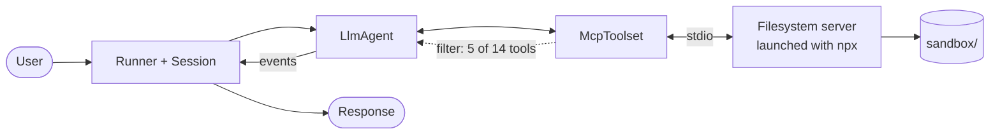

# 02 · Agent with MCP tools (Google ADK)

An agent that answers questions about the files in a local folder (`sandbox/`). It defines no
tools of its own: an external **Model Context Protocol** (MCP) server lends them, and the script
launches it and asks it, at startup, what it can do. It shows how to connect an agent to tools
that live outside your code.

> **Difference with `01`:** where the tools come from. There they were Python functions in the
> file; here they are a toolset served by an MCP server.

Same scenario in Strands Agents: [`strands-agents/02-mcp-agent`](../../strands-agents/02-mcp-agent).

## How it works



| | |
|---|---|
| Pattern | Single agent with external tools (MCP) |
| ADK pieces | `LlmAgent`, `McpToolset`, `StdioConnectionParams`, `tool_filter`, `LiteLlm`, `InMemoryRunner` |
| Tools | `read_text_file`, `list_directory`, `directory_tree`, `search_files`, `get_file_info`. None of its own |
| MCP server | `@modelcontextprotocol/server-filesystem@2026.8.31` (pinned version) |
| Model | `gpt-6-luna` (overridable with `MODEL_ID`) |

**Key ideas**

- **Tools are discovered at runtime.** `McpToolset` asks the server what it offers. The catalog is
  not written in the code; the example calls `get_tools()` at startup only to print it.
- **Allowlist, not denylist.** The server offers 14 tools and `tool_filter=[...]` lets through only
  the 5 read-only ones. The write tools never reach the model.
- **The toolset is one more entry in `tools`.** You can build the agent before the server is
  running: the session opens on first use.
- **Close what you open.** `await fs_toolset.close()` ends the MCP session and the server
  subprocess, also when the program fails.
- **Raise the timeout.** ADK waits 5 seconds by default, too little for the first `npx` download.

## Differences from Strands

| | Strands Agents | Google ADK |
|---|---|---|
| MCP connection | `MCPClient(lambda: stdio_client(...))` | `McpToolset(connection_params=StdioConnectionParams(...))` |
| Giving the tools to the agent | `list_tools_sync()`, then pass the list | Pass the toolset itself in `tools` |
| Allowlist | `tool_filters={"allowed": [...]}` | `tool_filter=[...]` |
| Session lifetime | `with fs_client:`; the agent is built inside | Opens on first use; closed with `close()` |
| Timeout | SDK default | Set to 60 s with `timeout` |
| MCP SDK | Listed in `requirements.txt` | Listed in `requirements.txt`; `google-adk` does not install it by default |

The differences between the two frameworks that already appear in
[`01`](../01-basic-tool-agent) (model, runner, events) also apply here.

## Setup and running

Requirements: Python 3.11+, **Node.js ≥ 18** (`node --version`) and an `OPENAI_API_KEY`. AWS and
Google Cloud are not needed.

```bash
cd google-adk/02-mcp-agent
python -m venv .venv && .venv/bin/pip install -r requirements.txt
cp .env.example .env          # put your OPENAI_API_KEY in it
.venv/bin/python agent.py     # 'exit' to quit
```

On Windows, use `.venv\Scripts\pip` and `.venv\Scripts\python` instead.

| Variable | Required | Use |
|---|---|---|
| `OPENAI_API_KEY` | Yes | Your OpenAI key |
| `MODEL_ID` | No | OpenAI model to use; defaults to `gpt-6-luna` |

> **The first start takes a few seconds** while `npx` downloads the server. It has not hung. The
> server prints its own startup messages, and `npm` may warn that this pinned version is deprecated.

## What to try

| You ask | Tool it uses |
|---|---|
| "what files are there?" | `list_directory` |
| "which port does the service listen on?" | `read_text_file` |
| "is there any .json file?" | `search_files` |
| "delete the notes file" | None: it has no write tools |

## Example conversation

> ⚠️ **Illustrative transcript:** the end-to-end run against the real model is still pending.

```text
MCP tools: ['directory_tree', 'get_file_info', 'list_directory', 'read_text_file', 'search_files']

You > which port does the service listen on?
Tool: directory_tree
Tool: read_text_file

FileBot > The service listens on port 8642.

You > what is the deployment code?
Tool: read_text_file

FileBot > The deployment code is KRAKEN-7743.

You > delete the notes file

FileBot > I can't delete it: I only have read access to the files in this environment.
```

**The proof:** `8642` and `KRAKEN-7743` only exist in the files in `sandbox/`, so the agent can
only answer by reading them. In the last turn there is no `Tool:` line.

## References

- [Agent Development Kit: MCP tools](https://google.github.io/adk-docs/tools-custom/mcp-tools/)
- [Model Context Protocol](https://modelcontextprotocol.io/)
- [Filesystem MCP server](https://github.com/modelcontextprotocol/servers/tree/main/src/filesystem)
- [LiteLLM models in ADK](https://google.github.io/adk-docs/agents/models/litellm/)
- Files: [`agent.py`](./agent.py) · [`requirements.txt`](./requirements.txt) · [`.env.example`](./.env.example) · [`sandbox/`](./sandbox/)
