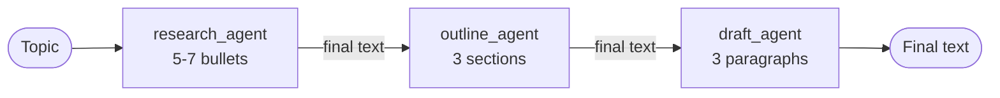

# 03 · Sequential agent pipeline (Google ADK)

Three agents in a row turn a topic into a text: one researches, another organizes and another
writes. The output of each one is the input of the next. It shows that **composing agents does not
need an orchestrator**: the chaining is three Python assignments.

> **Difference with `02`:** there are no tools or MCP. Instead there are three agents, one after
> the other.

Same scenario in Strands Agents: [`strands-agents/03-sequential-pipeline`](../../strands-agents/03-sequential-pipeline).

## How it works



| | |
|---|---|
| Pattern | Sequential pipeline, chained by hand |
| ADK pieces | `LlmAgent`, `LiteLlm`, `InMemoryRunner`, one session per call |
| Tools | None |
| Model | `gpt-6-luna` (overridable with `MODEL_ID`) |

**Key ideas**

- **Chaining is assigning.** `notes = await ask(research_agent, topic)`. `ask()` runs one turn and
  returns the agent's final text, ready to hand to the next stage.
- **The contract between stages lives in the `instruction`.** It is unstructured text, the most
  fragile form.
- **Every call starts blank.** In ADK the history lives in the session, and `ask()` creates a new
  one each time, so one topic does not carry over into the next.
- **It is not grounded.** Stage 1 works from memory, with no web or tools. Do not take its outputs
  as facts.

## Differences from Strands

| | Strands Agents | Google ADK |
|---|---|---|
| Calling an agent | `str(agent(text))` | `ask()`: runner, session and event stream |
| Forgetting the previous run | `agent.messages.clear()` | A new session per call |
| Entry point | Synchronous | `async`, with one `asyncio.run` |
| Framework alternative not used here | Multi-agent primitives | `SequentialAgent` (deprecated in favor of `Workflow`) |

ADK also adds a line with the agent's `name` to the system prompt it sends to the model. The
differences that already appear in [`01`](../01-basic-tool-agent) (model, runner, events) also
apply here.

## Setup and running

Requirements: Python 3.11+ and an `OPENAI_API_KEY`. AWS, Google Cloud and Node.js are not needed.

```bash
cd google-adk/03-sequential-pipeline
python -m venv .venv && .venv/bin/pip install -r requirements.txt
cp .env.example .env          # put your OPENAI_API_KEY in it
.venv/bin/python agent.py     # 'exit' to quit
```

On Windows, use `.venv\Scripts\pip` and `.venv\Scripts\python` instead.

| Variable | Required | Use |
|---|---|---|
| `OPENAI_API_KEY` | Yes | Your OpenAI key |
| `MODEL_ID` | No | OpenAI model to use; defaults to `gpt-6-luna` |

> **A few seconds of silence per stage:** responses are not streamed. The `[N/3]` banner shows
> which stage the pipeline is on.

## What to try

| You type | What to look at |
|---|---|
| "the impact of LLMs on education" | The three stages, each built on the previous one |
| A second, unrelated topic | Nothing from the first one carries over |
| A topic in another language | The three stages answer in that language |

## Example conversation

> ⚠️ **Illustrative transcript:** the end-to-end run against the real model is still pending.

```text
Topic > the impact of LLMs on education

[1/3] research ──►
- LLMs can act as an "instant tutor" that explains concepts, suggests exercises...
- The main pedagogical tension is between personalization and truthfulness...

[2/3] outline ──►
1. Instant tutor and limitations
2. Personalization, verification and assessment
3. Teaching, equity and mitigations

[3/3] draft ──►
Instant tutor and limitations
LLMs often work as an "instant tutor" that clarifies concepts...
```

**The proof:** the draft's headings are exactly the titles that stage 2 made up and that were not
in stage 1's bullets. Stage 3 could only know them through the chaining.

## References

- [Agent Development Kit: documentation](https://google.github.io/adk-docs/)
- [Multi-agent systems in ADK](https://google.github.io/adk-docs/agents/multi-agents/) (the primitives this example deliberately does not use)
- [LiteLLM models in ADK](https://google.github.io/adk-docs/agents/models/litellm/)
- Files: [`agent.py`](./agent.py) · [`requirements.txt`](./requirements.txt) · [`.env.example`](./.env.example)
