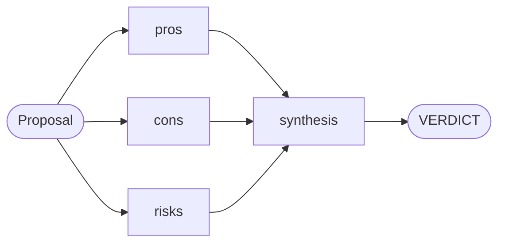

# 04 · Parallel agent fan-out (fan-out / fan-in, Google ADK)

Three agents analyze **the same** proposal at once (pros, cons and risks). A fourth waits for all
three and gives a verdict. It shows how to run agents in parallel when they do not depend on each
other: the total time approaches that of the slowest branch instead of the sum.

> **Difference with `03`:** the topology. Where there was a line, there is now a fan with
> `asyncio.gather`.

Same scenario in Strands Agents: [`strands-agents/04-parallel-fanout`](../../strands-agents/04-parallel-fanout).

## How it works



| | |
|---|---|
| Pattern | Fan-out / fan-in: 3 parallel branches and 1 aggregator |
| ADK pieces | `LlmAgent`, `LiteLlm`, `InMemoryRunner.run_async`, one session per call |
| Tools | None |
| Model | `gpt-6-luna` (overridable with `MODEL_ID`) |

**Key ideas**

- **The parallelism comes from `asyncio`, not ADK.** The whole fan is an `asyncio.gather` over
  `ask()`, on a single thread.
- **You parallelize what does not need each other.** In `03` each stage waited for the previous
  one. Here no branch needs another.
- **One session per branch.** Each call to `ask()` has its own runner and session, so the branches
  cannot see each other.
- **No streaming.** With three responses at once, the console would get mixed up.

## Differences from Strands

| | Strands Agents | Google ADK |
|---|---|---|
| Async call to an agent | `await agent.invoke_async(text)` | `ask()`: iterates `runner.run_async(...)` |
| Isolation between branches and runs | One instance per branch and `messages.clear()` | A new session per call |
| Entry point | `asyncio.run` for each proposal | One `asyncio.run` for the whole program |
| Framework alternative not used here | Multi-agent primitives | `ParallelAgent` (deprecated in favor of `Workflow`) |

The differences that already appear in [`01`](../01-basic-tool-agent) (model, runner, events) also
apply here.

## Setup and running

Requirements: Python 3.11+ and an `OPENAI_API_KEY`. AWS, Google Cloud and Node.js are not needed.
It adds no dependencies: `asyncio` is in the standard library.

```bash
cd google-adk/04-parallel-fanout
python -m venv .venv && .venv/bin/pip install -r requirements.txt
cp .env.example .env          # put your OPENAI_API_KEY in it
.venv/bin/python agent.py     # 'exit' to quit
```

On Windows, use `.venv\Scripts\pip` and `.venv\Scripts\python` instead.

| Variable | Required | Use |
|---|---|---|
| `OPENAI_API_KEY` | Yes | Your OpenAI key |
| `MODEL_ID` | No | OpenAI model to use; defaults to `gpt-6-luna` |

> **The timing lines come out in the order each branch finishes**, not in the order they are
> declared. That jumbled order shows they ran at the same time.

## What to try

| You type | What to look at |
|---|---|
| "adopt the 4-day work week" | `total` is close to the slowest branch, not the sum |
| The same proposal again | The branches may finish in a different order |
| Any other proposal | The verdict cites tags from all three analyses |

## Example conversation

> ⚠️ **Illustrative transcript:** the end-to-end run against the real model is still pending.

```text
Proposal > adopt the 4-day work week

[fan-out] lanzando 3 analistas en paralelo...
  risks  ──►   1.4s
  cons   ──►   1.7s
  pros   ──►   1.7s
  total:   1.7s  (en secuencia habrian sido 4.8s)

## PROS
P1 - ...

## CONS
C1 - ...

## RISKS
R1 - ...

[fan-in] synthesis ──►
VERDICT: conditional
- Potential benefits: higher productivity/focus and possibly lower absenteeism... (P1, P2)
- Operational feasibility depends on the context... (C1, R2)
```

**The proof:** the clock: `total` is far below the sum of the three branches. Also, the verdict
cites tags (`P1`, `C1`, `R2`) that only exist in the branch outputs.

## References

- [`asyncio.gather` in the Python documentation](https://docs.python.org/3/library/asyncio-task.html#asyncio.gather)
- [Multi-agent systems in ADK](https://google.github.io/adk-docs/agents/multi-agents/)
- [LiteLLM models in ADK](https://google.github.io/adk-docs/agents/models/litellm/)
- Files: [`agent.py`](./agent.py) · [`requirements.txt`](./requirements.txt) · [`.env.example`](./.env.example)
