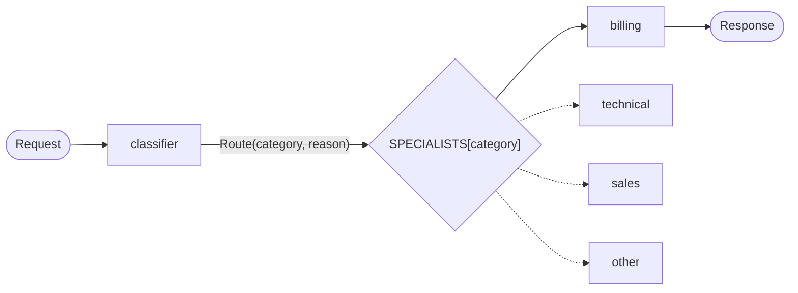

# 05 · Agent router (classify and dispatch, Google ADK)

A support agent that first **classifies** the request (billing, technical, sales or other) and
then hands it to **a single** specialist. The classification comes out as a typed, validated
object, not free text. It shows how to pick a request's route at a fixed cost: two model calls,
whether there are 4 destinations or 40.

> **Difference with `04`:** instead of running all the branches, it decides which one to run and
> only that one runs.

Same scenario in Strands Agents: [`strands-agents/05-router-agent`](../../strands-agents/05-router-agent).

## How it works



| | |
|---|---|
| Pattern | Router: the model classifies and the code dispatches |
| ADK pieces | `LlmAgent`, `output_schema`, `LiteLlm`, `InMemoryRunner` |
| Tools | None |
| Model | `gpt-6-luna` (overridable with `MODEL_ID`) |

**Key ideas**

- **A router is a structured output and a `dict`.** The classifier has `output_schema=Route`, and
  then `SPECIALISTS[route.category]` picks the agent.
- **The `Literal` closes the destinations.** The schema is sent in strict mode, so the model cannot
  invent a fifth category, and `Route.model_validate_json` checks the answer again.
- **The criterion lives in `Field(description=...)`.** To tune the classification you edit the
  description; you do not add an `if`.
- **The answer is still text.** With `output_schema` the final event carries JSON; the example turns
  it into a `Route` with Pydantic.

## Differences from Strands

| | Strands Agents | Google ADK |
|---|---|---|
| Structured output | Per call: `structured_output_model=Route` | Per agent: `LlmAgent(output_schema=Route)` |
| Reading the object | `.structured_output` | `Route.model_validate_json(text)` |
| Category type | `str` `Enum` | `Literal`: with an `Enum`, ADK drops the field's `description` from the schema |
| Invalid output | The SDK asks the model to correct itself | Validation raises an error; there is no retry |
| Forgetting the previous request | `agent.messages.clear()` | A new session per call |

The differences that already appear in [`01`](../01-basic-tool-agent) (model, runner, events) also
apply here.

## Setup and running

Requirements: Python 3.11+ and an `OPENAI_API_KEY`. AWS, Google Cloud and Node.js are not needed.
It adds `pydantic` to `requirements.txt` (it already came with `google-adk`).

```bash
cd google-adk/05-router-agent
python -m venv .venv && .venv/bin/pip install -r requirements.txt
cp .env.example .env          # put your OPENAI_API_KEY in it
.venv/bin/python agent.py     # 'exit' to quit
```

On Windows, use `.venv\Scripts\pip` and `.venv\Scripts\python` instead.

| Variable | Required | Use |
|---|---|---|
| `OPENAI_API_KEY` | Yes | Your OpenAI key |
| `MODEL_ID` | No | OpenAI model to use; defaults to `gpt-6-luna` |

> **The `[router]` line comes out before the response.** That way, if something goes wrong, you
> know whether the classification or the specialist failed.

## What to try

| You ask | Route |
|---|---|
| "you charged me twice for the March invoice" | `billing` |
| "the app crashes on open since the last update" | `technical` |
| "how much does it cost to upgrade to the team plan?" | `sales` |
| "do you work on public holidays?" | `other` |

## Example conversation

> ⚠️ **Illustrative transcript:** the end-to-end run against the real model is still pending.

The borderline case: it says "error" but it is about billing.

```text
Request > I was overcharged because of an error in the app

[router] billing ──► Overcharge due to an app error; request an adjustment/refund
I'm sorry about the error. To review it, I need: date and time of the charge, amount, currency...
```

**The proof:** each request makes exactly two model calls, the classifier and one specialist. The
`reason` is written by the model: it is not in `agent.py`.

## References

- [LLM agents in ADK: structured output](https://google.github.io/adk-docs/agents/llm-agents/)
- [Pydantic](https://docs.pydantic.dev/latest/)
- [LiteLLM models in ADK](https://google.github.io/adk-docs/agents/models/litellm/)
- Files: [`agent.py`](./agent.py) · [`requirements.txt`](./requirements.txt) · [`.env.example`](./.env.example)
