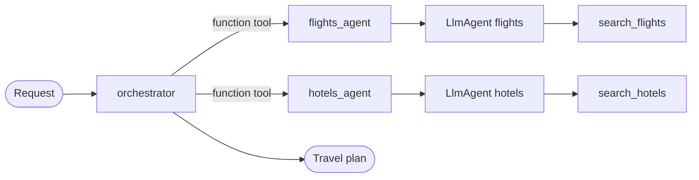

# 06 · Agents as tools (Google ADK)

A travel orchestrator with two tools that are really **agents**: one searches flights and the
other hotels, each with its own data tool. The orchestrator decides whom to call, in what order and
how many times. It shows hierarchical composition without any multi-agent primitive: an
agent-tool is a function that runs an `LlmAgent`.

> **Difference with `05`:** the line that dispatches is gone. Now the model decides, not the code.

Same scenario in Strands Agents: [`strands-agents/06-agents-as-tools`](../../strands-agents/06-agents-as-tools).

## How it works



| | |
|---|---|
| Pattern | Agents as tools (2-level hierarchy) |
| ADK pieces | `LlmAgent`, function tools, `LiteLlm`, `InMemoryRunner` |
| Tools | 4: `flights_agent`, `hotels_agent` (wrap agents), `search_flights`, `search_hotels` (read data) |
| Model | `gpt-6-luna` (overridable with `MODEL_ID`) |

**Key ideas**

- **An agent-tool is a function.** An `async` function that runs the sub-agent with `ask()` and
  returns its text. To the orchestrator it is the same as any other tool.
- **The docstring is the dispatch criterion.** If the orchestrator picks wrong, you fix the
  docstring; you do not add an `if`.
- **Not delegating is also an option.** Given a general question, the orchestrator answers on its
  own.
- **The cost stops being fixed.** Depending on what the model decides, a turn costs 1, 4, 6 or 7
  calls. ADK also offers `AgentTool`; here the wrapper is written by hand so the mechanism is
  visible.

## Differences from Strands

| | Strands Agents | Google ADK |
|---|---|---|
| Wrapping an agent | `@tool` function returning `str(agent(request))` | Plain `async` function returning `await ask(agent, request)` |
| Ready-made wrapper | `Agent.as_tool()` | `AgentTool` |
| Sub-agent history | `a.messages.clear()` before each turn | A new session on every call, also within the same turn |

The differences that already appear in [`01`](../01-basic-tool-agent) (model, runner, events) also
apply here.

## Setup and running

Requirements: Python 3.11+ and an `OPENAI_API_KEY`. AWS, Google Cloud and Node.js are not needed.

```bash
cd google-adk/06-agents-as-tools
python -m venv .venv && .venv/bin/pip install -r requirements.txt
cp .env.example .env          # put your OPENAI_API_KEY in it
.venv/bin/python agent.py     # 'exit' to quit
```

On Windows, use `.venv\Scripts\pip` and `.venv\Scripts\python` instead.

| Variable | Required | Use |
|---|---|---|
| `OPENAI_API_KEY` | Yes | Your OpenAI key |
| `MODEL_ID` | No | OpenAI model to use; defaults to `gpt-6-luna` |

> **The `[tool] … ──►` lines show the delegation as it happens.** If you see none, the
> orchestrator answered on its own.

## What to try

| You ask | Specialists called |
|---|---|
| "3 days in Lisbon, I need a flight and a hotel" | `flights_agent` + `hotels_agent` |
| "where do I sleep in Porto?" | `hotels_agent` |
| "do I need a passport to travel within the EU?" | None |
| "I want to fly to Tokyo next week" | `flights_agent` (it is not in the catalog and says so) |

## Example conversation

> ⚠️ **Illustrative transcript:** the end-to-end run against the real model is still pending.

```text
Trip > 3 days in Lisbon, I need a flight and a hotel
  [tool] flights_agent ──►
  [tool] hotels_agent ──►

**Flights:** For Lisbon, there is flight **IB-4417 (08:05-09:25) for 412 EUR**.

**Hotel:** I found **Casa Kraken, Alfama** (**94 EUR/night**).
```

**The proof:** `IB-4417` only exists in a Python `dict`. To reach the final plan it went through
four hops (`search_flights` → `flights` → `flights_agent` → `orchestrator`). The data is made up
on purpose.

## References

- [Agent Development Kit: function tools](https://google.github.io/adk-docs/tools-custom/function-tools/)
- [Multi-agent systems in ADK](https://google.github.io/adk-docs/agents/multi-agents/) (includes `AgentTool`)
- [LiteLLM models in ADK](https://google.github.io/adk-docs/agents/models/litellm/)
- Files: [`agent.py`](./agent.py) · [`requirements.txt`](./requirements.txt) · [`.env.example`](./.env.example)
