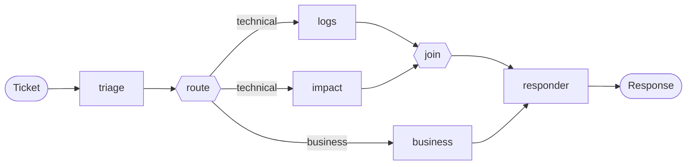

# 07 · Agent graph (Google ADK)

A support desk with five agents connected by **edges declared before anything runs**. `triage`
classifies the ticket and the graph follows either the technical branch (`logs` and `impact` in
parallel) or the business one (`business`); `responder` writes the final reply. It shows a
multi-agent architecture that reads like a diagram and is walked by the framework, not by your
code.

> **Difference with `06`:** no line of Python relates two agents at runtime. The connections are
> declared as the `edges` of a `Workflow`, which walks them.

Same scenario in Strands Agents: [`strands-agents/07-agent-graph`](../../strands-agents/07-agent-graph).

## How it works



| | |
|---|---|
| Pattern | Agent graph with conditional edges |
| ADK pieces | `Workflow`, `START`, `JoinNode`, `Event(route=...)`, `{ticket}` in `instruction`, `InMemoryRunner(node=...)` |
| Tools | None: all five agents are text in, text out |
| Model | `gpt-6-luna` (overridable with `MODEL_ID`) |

**Key ideas**

- **The topology is data.** The whole architecture is the `edges` list in one block of `agent.py`.
  Each branch has a cost you can count before running: 4 model calls (technical) or 3 (business).
- **A function can be a node.** `route` reads the verdict of `triage`, picks a branch with
  `Event(route=...)` and passes the ticket on to it. It is not an agent and costs nothing.
- **A node only sees the output of the one before it.** That is why `route` forwards the ticket and
  `responder` reads it from the session state through `{ticket}` in its instruction.
- **Fan-in is explicit.** `JoinNode` waits for `logs` and `impact` and hands `responder` a dict with
  both notes, keyed by name. `business` goes straight to `responder`.

## Differences from Strands

| | Strands Agents | Google ADK |
|---|---|---|
| Graph | `GraphBuilder`: `add_node`, `add_edge`, `build()` | `Workflow(edges=[...])`; nodes are inferred from the edges |
| Condition | A function on each edge: `condition=is_technical` | A function node emits a route and the edges are keyed by it |
| Waiting for two branches | Nothing to declare | `JoinNode` |
| What a node receives | The original ticket and its dependencies' output | Only the previous node's output |
| Loop guard | `set_max_node_executions` | Not set: this graph has no cycle |
| Which path ran | `result.execution_order` | The author of each event |
| History between tickets | Cleared by hand | A new session per ticket |

The differences between the two frameworks that already appear in
[`01`](../01-basic-tool-agent) (model, runner, events) also apply here.

## Setup and running

Requirements: Python 3.11+ and an `OPENAI_API_KEY`. AWS and Google Cloud are not needed.

```bash
cd google-adk/07-agent-graph
python -m venv .venv && .venv/bin/pip install -r requirements.txt
cp .env.example .env          # put your OPENAI_API_KEY in it
.venv/bin/python agent.py     # 'exit' to quit
```

On Windows, use `.venv\Scripts\pip` and `.venv\Scripts\python` instead.

| Variable | Required | Use |
|---|---|---|
| `OPENAI_API_KEY` | Yes | Your OpenAI key |
| `MODEL_ID` | No | OpenAI model to use; defaults to `gpt-6-luna` |

> **The `[graph]` line comes out after the run**, together with the reply: the example collects the
> authors of the events while the `Workflow` walks the graph.

## What to try

| You ask | Path |
|---|---|
| "CSV export has been failing with a 500 error since yesterday" | `triage → logs + impact → responder` (4 calls) |
| "You charged me twice for this month's fee" | `triage → business → responder` (3 calls) |

## Example conversation

> ⚠️ **Illustrative transcript:** the end-to-end run against the real model is still pending.

```text
Ticket > CSV export has been failing with a 500 error since yesterday

[graph] triage ──► logs ──► impact ──► responder
Since yesterday CSV export has been failing with a 500 error. We will check the server error logs
for the export request first. Please tell us roughly when it started and the file size.

Ticket > You charged me twice for this month's fee

[graph] triage ──► business ──► responder
Thanks for letting us know. To look into the double charge, please send us the date and amount of
both charges and the invoice number.
```

**The proof:** the `[graph]` line is built from the events the `Workflow` emitted, not from prints
inside the branches. On the second ticket `logs` and `impact` do not appear. The order between
`logs` and `impact` may vary: they run at the same time.

## References

- [Agent Development Kit: documentation](https://google.github.io/adk-docs/)
- [Graph-based workflows in ADK](https://google.github.io/adk-docs/graphs/)
- [LiteLLM models in ADK](https://google.github.io/adk-docs/agents/models/litellm/)
- Files: [`agent.py`](./agent.py) · [`requirements.txt`](./requirements.txt) · [`.env.example`](./.env.example)
