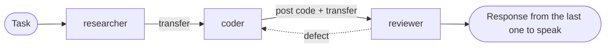

# 08 · Agent swarm (Google ADK)

A small development team of three agents (`researcher`, `coder`, `reviewer`) that hand control to
each other to write a Python function. There is no orchestrator and no connections: each agent
decides who goes next. It shows coordination with no central control, where the reviewer can send
the work back to the coder, something the graph in `07` is not wired to do.

> **Difference with `07`:** the edges are gone. The architecture is three agents and a limit; the
> agents themselves decide the path while they run.

Same scenario in Strands Agents: [`strands-agents/08-agent-swarm`](../../strands-agents/08-agent-swarm).

## How it works



| | |
|---|---|
| Pattern | Swarm: autonomous peers that hand control to each other |
| ADK pieces | `LlmAgent(description=, sub_agents=)`, the injected `transfer_to_agent` tool, `RunConfig(max_llm_calls=)`, `InMemoryRunner` |
| Tools | `post` (written here) and `transfer_to_agent` (injected by ADK) |
| Model | `gpt-6-luna` (overridable with `MODEL_ID`) |

**Key ideas**

- **`description=` is the routing criterion.** ADK shows it to each agent in the list of agents it
  can transfer to.
- **A transfer carries no message.** `transfer_to_agent` only names the destination. The team
  shares one session history, so each agent publishes its work with `post` before transferring, and
  the others read the arguments of that call.
- **The swarm ends when an agent goes quiet.** If it answers without transferring, the task is
  finished. The stop condition lives in `REVIEWER_PROMPT`, not in the code.
- **The limit is mandatory.** With no orchestrator, `max_llm_calls=12` is what bounds the run. When
  it is reached ADK raises an error and the example reports `failed`.

## Differences from Strands

| | Strands Agents | Google ADK |
|---|---|---|
| The team | `Swarm([...])`, a flat list | A tree: `researcher` holds the other two as `sub_agents`; all three can reach each other |
| Handoff tool | `handoff_to_agent`, with a message and context | `transfer_to_agent`, with only the agent name |
| How the code travels | In the handoff message | In the shared history, published with `post` |
| Hand-written tools | None | `post` |
| Limits | `max_handoffs`, `max_iterations`, `node_timeout`, repeated-handoff detection | `max_llm_calls` only |
| Trace | `swarm.stream_async()` events | `event.actions.transfer_to_agent` on the Runner's events |
| Final status | `result.status` | Set by the example when `LlmCallsLimitExceededError` is raised |

The differences between the two frameworks that already appear in
[`01`](../01-basic-tool-agent) (model, runner, events) also apply here.

## Setup and running

Requirements: Python 3.11+ and an `OPENAI_API_KEY`. AWS and Google Cloud are not needed.

```bash
cd google-adk/08-agent-swarm
python -m venv .venv && .venv/bin/pip install -r requirements.txt
cp .env.example .env          # put your OPENAI_API_KEY in it
.venv/bin/python agent.py     # 'exit' to quit
```

On Windows, use `.venv\Scripts\pip` and `.venv\Scripts\python` instead.

| Variable | Required | Use |
|---|---|---|
| `OPENAI_API_KEY` | Yes | Your OpenAI key |
| `MODEL_ID` | No | OpenAI model to use; defaults to `gpt-6-luna` |

> **Here the trace comes out during the run**, one line per transfer. `agent.py` silences ADK's own
> log messages so that only that trace shows.

## What to try

| You ask | Likely path |
|---|---|
| "a function that groups a list of dicts by a key, where some are missing it" | `researcher → coder → reviewer`, maybe with a round back to `coder` |
| "a function that parses a duration like '1h30m' into seconds" | `researcher → coder → reviewer` |

## Example conversation

> ⚠️ **Illustrative transcript:** the end-to-end run against the real model is still pending.

```text
Task > a function that groups a list of dicts by a key, where some are missing it

[researcher] pensando...
  researcher ──► coder: 1. Input: list of dicts and a key. 2. Output: dict of lists. ...

[coder] pensando...
  coder ──► reviewer: def group_by(items, key): ...

[reviewer] pensando...
  reviewer ──► coder: Defect: items missing the key raise KeyError.

[coder] pensando...
  coder ──► reviewer: def group_by(items, key, default=None): ...

[reviewer] pensando...

[swarm] researcher ──► coder ──► reviewer ──► coder ──► reviewer  (completed)
Approved. Items without the key go to the default bucket.
```

**The proof:** each arrow comes from a transfer event emitted by ADK, and no line of `agent.py`
asks for `coder` to run twice. The code `coder` writes is never run: the "Approved" is another
LLM's opinion, not proof that the function works.

## References

- [Agent Development Kit: documentation](https://google.github.io/adk-docs/)
- [Multi-agent systems in ADK](https://google.github.io/adk-docs/agents/multi-agents/)
- [LiteLLM models in ADK](https://google.github.io/adk-docs/agents/models/litellm/)
- Files: [`agent.py`](./agent.py) · [`requirements.txt`](./requirements.txt) · [`.env.example`](./.env.example)
