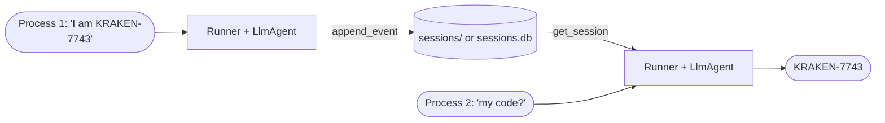

# 09 · Persistent session agent (Google ADK)

Mnemo is a single-agent assistant with no tools whose conversation **survives a process restart**.
You tell it a fact in one run, close the program, and in the next run it remembers it. It shows how
ADK saves the history without any `save()` or `load()`, and how to switch the store (a custom JSON
one or the built-in SQLite one) without touching the agent.

> **Difference with `08`:** back to a single agent, and the change is relative to `01`: the same
> `LlmAgent`, run with a session service that writes to disk.

Same scenario in Strands Agents:
[`strands-agents/09-persistent-session-agent`](../../strands-agents/09-persistent-session-agent).

## How it works



| | |
|---|---|
| Pattern | Single agent with state persisted across processes |
| ADK pieces | `Runner(session_service=)`, `BaseSessionService`, `SqliteSessionService`, `InMemorySessionService` |
| Tools | None |
| Code files | `agent.py` + `json_session.py` (custom JSON store) |
| Model | `gpt-6-luna` (overridable with `MODEL_ID`) |

**Key ideas**

- **There is no `save()` or `load()`.** The `Runner` calls `append_event` on the session service
  for each message. Getting the session back does not call the model.
- **The store is pluggable.** `json_session.py` implements `BaseSessionService`. `agent.py` uses it
  the same way as the SQLite one that ships with ADK.
- **The `session_id` is the memory's key.** Two different ids are two different memories, and the
  same id in another store is **another** conversation.
- **Unlike in `01`, you ask before creating.** `get_session` returns `None` the first time; only
  then is `create_session` called.
- **Messages are saved, not code.** The instruction and the model always come from the file. The
  conversation is stored in plain text: `sessions/` and `*.db` are in `.gitignore`.

## Differences from Strands

| | Strands Agents | Google ADK |
|---|---|---|
| Where persistence plugs in | `Agent(session_manager=...)` | `Runner(session_service=...)`; the agent has no parameter for it |
| Built-in file store | `FileSessionManager` (JSON) | `SqliteSessionService` |
| Custom store in the example | SQLite (`sqlite_session.py`) | JSON (`json_session.py`) |
| No memory | `session_manager=None` | `InMemorySessionService` |
| What is stored | Messages | Events |
| Printing | The response comes out twice | Once |

The JSON store is deliberately small: it ignores the `config` filter of `get_session` and does not
share `app:` or `user:` state between sessions.

The differences between the two frameworks that already appear in
[`01`](../01-basic-tool-agent) (model, runner, events) also apply here.

## Setup and running

Requirements: Python 3.11+ and an `OPENAI_API_KEY`. AWS and Google Cloud are not needed.

```bash
cd google-adk/09-persistent-session-agent
python -m venv .venv && .venv/bin/pip install -r requirements.txt
cp .env.example .env                          # put your OPENAI_API_KEY in it
.venv/bin/python agent.py ana                 # session 'ana' in JSON; 'exit' to quit
.venv/bin/python agent.py ana --sqlite        # the same session, but in SQLite
.venv/bin/python agent.py ana --no-session    # no memory, like 01-08
```

On Windows, use `.venv\Scripts\pip` and `.venv\Scripts\python` instead.

| Variable / argument | Required | Use |
|---|---|---|
| `OPENAI_API_KEY` | Yes | Your OpenAI key |
| `MODEL_ID` | No | OpenAI model to use; defaults to `gpt-6-luna` |
| `session_id` (argument) | No | Name of the memory; defaults to `default` |
| `--sqlite` / `--no-session` | No | Switches the store or removes it |

> To start from scratch: `rm -rf sessions sessions.db`.

## What to try

| Run | `restored messages` | Answer to "what is my member code?" |
|---|---|---|
| `ana` (after telling it the code) | 2 | `KRAKEN-7743` |
| `bruno` | 0 | It does not know |
| `ana --no-session` | 0 | It does not know |
| `ana --sqlite` | 0 | It does not know (another store, another memory) |

## Example conversation

> ⚠️ **Illustrative transcript:** the end-to-end run against the real model is still pending.

Two processes in a row:

```text
Session 'ana' | store: JsonSessionService | restored messages: 0

You > my member code is KRAKEN-7743

Mnemo > Got it. Your member code is KRAKEN-7743.

You > exit

Session 'ana' | store: JsonSessionService | restored messages: 2

You > what is my member code?

Mnemo > Your member code is KRAKEN-7743.
```

**The proof:** `restored messages: 2` is printed before the model speaks (it comes from
`len(session.events)`). `KRAKEN-7743` cannot be guessed, and with `bruno` the agent does not know
it.

## References

- [Sessions in ADK](https://google.github.io/adk-docs/sessions/session/)
- [Agent Development Kit: documentation](https://google.github.io/adk-docs/)
- [LiteLLM models in ADK](https://google.github.io/adk-docs/agents/models/litellm/)
- Files: [`agent.py`](./agent.py) · [`json_session.py`](./json_session.py) · [`requirements.txt`](./requirements.txt) · [`.env.example`](./.env.example)
