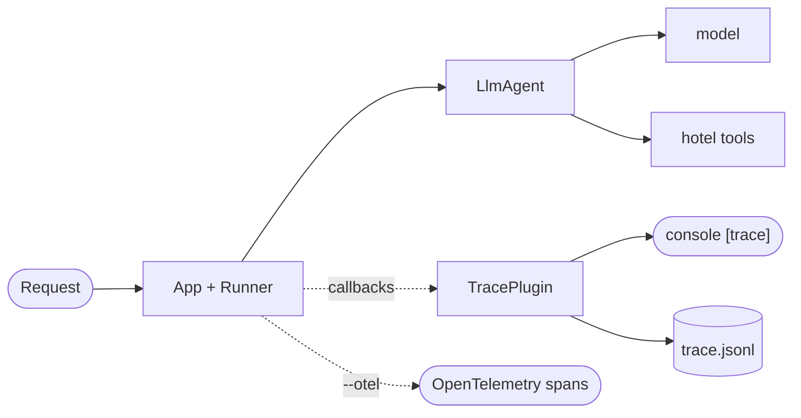

# 10 · Observable agent (Google ADK)

Concierge is a hotel-booking assistant with three tools (`check_availability`, `book_room`,
`cancel_booking`) that **leaves a trail of everything that happens in each turn**: which tool it
called, with what data, how long it took and how many tokens it spent. The trail comes from an
external observer (`observability.py`) that the agent knows nothing about. With `--otel`, it also
exports the OpenTelemetry spans that ADK was already emitting.

> **Difference with `09`:** instead of saving the conversation, it records what happens during the
> turn. The agent from `01`, wrapped in an `App` with one plugin: `plugins=[TracePlugin(...)]`.

Same scenario in Strands Agents:
[`strands-agents/10-observable-agent`](../../strands-agents/10-observable-agent).

## How it works



| | |
|---|---|
| Pattern | Single agent with external observability |
| ADK pieces | `BasePlugin` callbacks, `App(plugins=)`, `maybe_set_otel_providers`, `OTelHooks` |
| Tools | 3: `check_availability`, `book_room`, `cancel_booking` |
| Code files | `agent.py` + `observability.py` |
| Model | `gpt-6-luna` (overridable with `MODEL_ID`) |

**Key ideas**

- **The observer does not touch the agent.** There is not a single `print` inside the tools.
  Removing `plugins=[...]` leaves the agent the same and with no trail.
- **Six callbacks are enough:** start and end of the run, of each model call and of each tool. Two
  more (`on_tool_error_callback`, `on_run_error_callback`) cover exceptions.
- **A callback that returns `None` only observes.** Returning a value would replace what the model
  or the tool produced.
- **`status="success"` is not business success.** A tool that returns `"Unknown booking code"`
  comes out as `success`: it only means that nothing was raised. You have to read the `result`.
- **The plugin does its own measuring.** It times each tool and adds up the tokens of each model
  response in the turn.

## Differences from Strands

| | Strands Agents | Google ADK |
|---|---|---|
| Observer | `HookProvider`, passed as `Agent(hooks=[...])` | `BasePlugin`, registered in `App(plugins=[...])` |
| Subscription | `registry.add_callback(EventType, fn)` | Override the callback methods |
| Tool duration | `event.duration` | Timed by the plugin |
| Tokens and cycles | Cumulative SDK metrics, subtracted per turn | Counted by the plugin from `usage_metadata` |
| `stop_reason` | Given by the event | Deduced: `tool_use` if the response asks for a tool |
| Tool status | `event.result["status"]` | Success or error depending on which callback runs |
| `--otel` | `StrandsTelemetry().setup_console_exporter()` | `maybe_set_otel_providers` with a console exporter |
| What the spans hold | The whole conversation | Names, model, tool and ids; not the conversation text with the default settings |
| Silencing SDK prints | `callback_handler=None` | Not needed |

The trace keeps the event names of the Strands example, so both trails can be compared line by line.

The differences between the two frameworks that already appear in
[`01`](../01-basic-tool-agent) (model, runner, events) also apply here.

## Setup and running

Requirements: Python 3.11+ and an `OPENAI_API_KEY` (OpenTelemetry already comes with
`google-adk`). AWS and Google Cloud are not needed.

```bash
cd google-adk/10-observable-agent
python -m venv .venv && .venv/bin/pip install -r requirements.txt
cp .env.example .env              # put your OPENAI_API_KEY in it
.venv/bin/python agent.py         # trail on the console + trace.jsonl; 'exit' to quit
.venv/bin/python agent.py --otel  # plus the OpenTelemetry spans on the console
```

On Windows, use `.venv\Scripts\pip` and `.venv\Scripts\python` instead.

| Variable | Required | Use |
|---|---|---|
| `OPENAI_API_KEY` | Yes | Your OpenAI key |
| `MODEL_ID` | No | OpenAI model to use; defaults to `gpt-6-luna` |

> **`trace.jsonl` stores prompts and results in plain text.** It is in `.gitignore`; delete it with
> `rm -f trace.jsonl`.

## What to try

| You ask | Tool called | Result |
|---|---|---|
| "is there room on October 4?" | `check_availability` | `7 rooms free on 2026-10-04.` |
| "cancel booking ZZZ-0000" | `cancel_booking` | `Unknown booking code` (with `status="success"`) |
| "what are you?" | None | `cycles=1 tools=0` |

## Example conversation

> ⚠️ **Illustrative transcript:** the end-to-end run against the real model is still pending. The
> trace lines have the format the plugin prints; durations, tokens and wording will differ.

```text
You > is there room on October 4?
[trace] 001 turn=1 before_invocation  prompt="is there room on October 4?"
[trace] 002 turn=1 before_model_call  messages=1
[trace] 003 turn=1 after_model_call   stop_reason="tool_use"
[trace] 004 turn=1 before_tool_call   tool="check_availability"  input={"date": "2026-10-04"}
[trace] 005 turn=1 after_tool_call    tool="check_availability"  status="success"  duration_ms=0.31
                                      result="7 rooms free on 2026-10-04."
[trace] 006 turn=1 before_model_call  messages=3
[trace] 007 turn=1 after_model_call   stop_reason="end_turn"

Concierge > Yes, there is room on October 4, 2026: 7 rooms are free.
[trace] 008 turn=1 after_invocation   cycles=2  tools=1  tokens=624
```

**The proof:** each `[trace]` line is written by the plugin from an ADK callback, and the same line
is stored as JSON in `trace.jsonl`. The `7` rooms only exist in a `dict` in `agent.py`. The summary
line comes after the reply because the run ends once its last event has been delivered.

## References

- [Plugins in ADK](https://google.github.io/adk-docs/plugins/)
- [Observability in ADK](https://google.github.io/adk-docs/observability/)
- [LiteLLM models in ADK](https://google.github.io/adk-docs/agents/models/litellm/)
- Files: [`agent.py`](./agent.py) · [`observability.py`](./observability.py) · [`requirements.txt`](./requirements.txt) · [`.env.example`](./.env.example)
