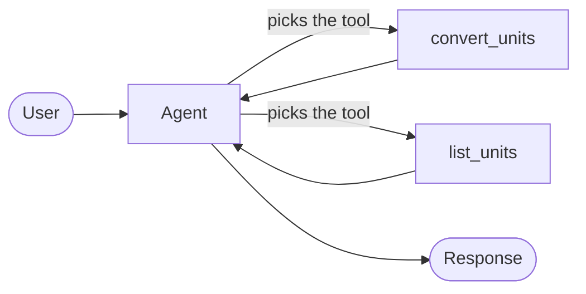

# 01 · Basic agent with tools

A single agent that converts units (length, mass and temperature) using two custom tools defined
with `@tool`. It is the simplest example in the collection and the base for all the others: it
shows how a model decides on its own when to call a Python function. The domain is a converter
because its result can be checked at a glance.

> **Difference with the previous one:** none. It is the starting point of the collection.

## How it works



| | |
|---|---|
| Pattern | Single agent |
| Strands pieces | `Agent`, `@tool`, `OpenAIResponsesModel` |
| Tools | `convert_units`, `list_units` (no arguments) |
| Model | `gpt-6-luna` (overridable with `MODEL_ID`) |

**Key ideas**

- **The docstring and the type hints are the schema.** This is what the model reads to decide when
  and how to call each tool. You write no `if`: the SDK takes care of that.
- **Errors are returned as text.** Given an unknown unit, `convert_units` returns a message. The
  model reads it and corrects itself in the same turn.
- **The key never appears in the code.** `load_dotenv()` loads it into the environment and the
  `openai` client picks it up from there.

## Setup and running

Requirements: Python 3.10+ and an `OPENAI_API_KEY`. AWS is not needed.

```bash
cd strands-agents/01-basic-tool-agent
python -m venv .venv && .venv/bin/pip install -r requirements.txt
cp .env.example .env          # put your OPENAI_API_KEY in it
.venv/bin/python agent.py     # 'exit' to quit
```

| Variable | Required | Use |
|---|---|---|
| `OPENAI_API_KEY` | Yes | Your OpenAI key |
| `MODEL_ID` | No | Model to use; defaults to `gpt-6-luna` |

> To try another model for a single run: `MODEL_ID=gpt-5.4 .venv/bin/python agent.py`.

## Examples

| You ask | What happens |
|---|---|
| "how many miles is 100 km?" | Calls `convert_units` → `62.1371` |
| "which units do you support?" | Calls `list_units` |
| "convert 5 gallons to liters" | `convert_units` fails → checks `list_units` → explains the limit |

> ⚠️ **Illustrative transcript:** the end-to-end test against the real model is still pending (there
> was no `OPENAI_API_KEY`). The tools are verified and do return these values.

```text
You > how many miles is 100 km?
Tool #1: convert_units

UnitBot > 100 km is 62.1371 miles.

You > convert 5 gallons to liters
Tool #3: convert_units
Tool #4: list_units

UnitBot > I don't handle gallons or liters. I can convert length, mass and temperature.
```

**The proof:** each `Tool #N` line is printed by Strands when it runs the tool. The model does not
make the number up.

## References

- [Strands Agents: documentation](https://strandsagents.com/)
- [Custom tools (`@tool`)](https://strandsagents.com/docs/user-guide/concepts/tools/custom-tools/)
- [OpenAI provider](https://strandsagents.com/docs/user-guide/concepts/model-providers/openai/) and [Responses API](https://strandsagents.com/docs/user-guide/concepts/model-providers/openai-responses/)
- Files: [`agent.py`](./agent.py) · [`requirements.txt`](./requirements.txt) · [`.env.example`](./.env.example)
