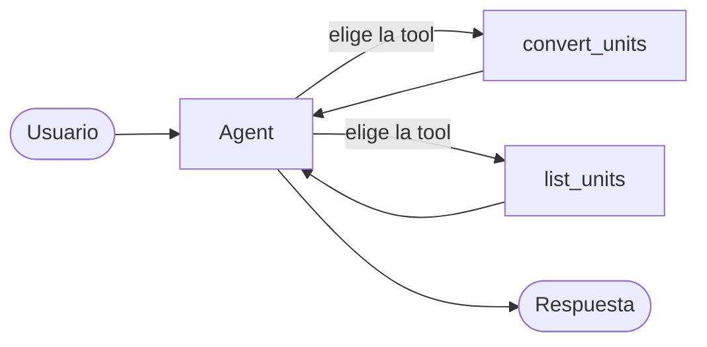

# 01 · Agente básico con herramientas

Un único agente que convierte unidades (longitud, masa y temperatura) usando dos herramientas
propias definidas con `@tool`. Es el ejemplo más simple de la colección y la base de todos los
demás: muestra cómo un modelo decide por sí solo cuándo llamar a una función de Python. El
dominio es un conversor porque su resultado se comprueba a simple vista.

> **Diferencia con el anterior:** ninguna. Es el punto de partida de la colección.

## Cómo funciona



| | |
|---|---|
| Patrón | Agente único |
| Piezas de Strands | `Agent`, `@tool`, `OpenAIResponsesModel` |
| Herramientas | `convert_units`, `list_units` (sin argumentos) |
| Modelo | `gpt-5.4-mini` (cambiable con `MODEL_ID`) |

**Ideas clave**

- **El docstring y los tipos son el esquema.** Es lo que lee el modelo para decidir cuándo y cómo
  llamar a cada herramienta. No escribes ningún `if`: eso lo pone el SDK.
- **Los errores se devuelven como texto.** Ante una unidad desconocida, `convert_units` devuelve
  un mensaje. El modelo lo lee y se corrige en el mismo turno.
- **La clave nunca aparece en el código.** `load_dotenv()` la carga en el entorno y el cliente de
  `openai` la toma de ahí.

## Configuración y ejecución

Requisitos: Python 3.10+ y una `OPENAI_API_KEY`. No hace falta AWS.

```bash
cd strands-agents/01-basic-tool-agent
python -m venv .venv && .venv/bin/pip install -r requirements.txt
cp .env.example .env          # pon tu OPENAI_API_KEY
.venv/bin/python agent.py     # 'exit' para salir
```

| Variable | Obligatoria | Uso |
|---|---|---|
| `OPENAI_API_KEY` | Sí | Tu clave de OpenAI |
| `MODEL_ID` | No | Modelo a usar; por defecto `gpt-5.4-mini` |

> Para probar otro modelo en una sola ejecución: `MODEL_ID=gpt-5.4 .venv/bin/python agent.py`.

## Ejemplos

| Pides | Qué pasa |
|---|---|
| "¿cuántas millas son 100 km?" | Llama a `convert_units` → `62.1371` |
| "¿qué unidades manejas?" | Llama a `list_units` |
| "convierte 5 galones a litros" | `convert_units` falla → consulta `list_units` → explica el límite |

> ⚠️ **Transcripción ilustrativa:** la prueba de punta a punta contra el modelo real quedó
> pendiente (no había `OPENAI_API_KEY`). Las herramientas sí están verificadas y devuelven estos valores.

```text
You > ¿cuántas millas son 100 km?
Tool #1: convert_units

UnitBot > 100 km son 62.1371 millas.

You > convierte 5 galones a litros
Tool #3: convert_units
Tool #4: list_units

UnitBot > No manejo galones ni litros. Puedo convertir longitud, masa y temperatura.
```

**La prueba:** cada línea `Tool #N` la imprime Strands al ejecutar la herramienta. El número no lo
inventa el modelo.

## Referencias

- [Strands Agents: documentación](https://strandsagents.com/)
- [Herramientas personalizadas (`@tool`)](https://strandsagents.com/docs/user-guide/concepts/tools/custom-tools/)
- [Proveedor OpenAI](https://strandsagents.com/docs/user-guide/concepts/model-providers/openai/) y [API Responses](https://strandsagents.com/docs/user-guide/concepts/model-providers/openai-responses/)
- Archivos: [`agent.py`](./agent.py) · [`requirements.txt`](./requirements.txt) · [`.env.example`](./.env.example)
