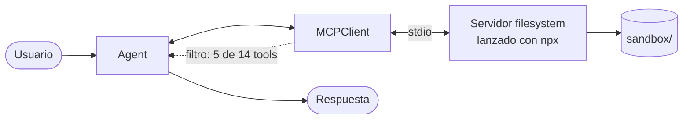

# 02 · Agente con herramientas MCP

Un agente que responde preguntas sobre los archivos de una carpeta local (`sandbox/`). No define
ninguna herramienta propia: se las presta un servidor externo del **Model Context Protocol**
(MCP), que el script lanza y al que pregunta, al arrancar, qué sabe hacer. Sirve para ver cómo
conectar un agente a herramientas que viven fuera de tu código.

> **Diferencia con `01`:** de dónde salen las herramientas. Allí eran funciones `@tool` del
> archivo; aquí son una lista que devuelve un servidor MCP.

## Cómo funciona



| | |
|---|---|
| Patrón | Agente único con herramientas externas (MCP) |
| Piezas de Strands | `Agent`, `MCPClient`, `list_tools_sync`, `tool_filters`, `OpenAIResponsesModel` |
| Herramientas | `read_text_file`, `list_directory`, `directory_tree`, `search_files`, `get_file_info`. Ninguna propia |
| Servidor MCP | `@modelcontextprotocol/server-filesystem@2026.8.31` (versión fijada) |
| Modelo | `gpt-5.4-nano` (cambiable con `MODEL_ID`) |

**Ideas clave**

- **Las herramientas se descubren al arrancar.** `list_tools_sync()` pregunta al servidor qué
  ofrece. El catálogo no está escrito en el código.
- **Lista blanca, no lista negra.** El servidor ofrece 14 tools y `tool_filters={"allowed": [...]}`
  solo deja pasar las 5 de lectura. Las de escritura nunca llegan al modelo.
- **Todo vive dentro de `with fs_client:`.** Las tools solo funcionan con la sesión abierta. Si
  creas el agente fuera, falla con `MCPClientInitializationError` en la primera llamada.

## Configuración y ejecución

Requisitos: Python 3.10+, **Node.js ≥ 18** (`node --version`) y una `OPENAI_API_KEY`.

```bash
cd strands-agents/02-mcp-agent
python -m venv .venv && .venv/bin/pip install -r requirements.txt
cp .env.example .env          # pon tu OPENAI_API_KEY
.venv/bin/python agent.py     # 'exit' para salir
```

| Variable | Obligatoria | Uso |
|---|---|---|
| `OPENAI_API_KEY` | Sí | Tu clave de OpenAI |
| `MODEL_ID` | No | Modelo a usar; por defecto `gpt-5.4-nano` |

> **El primer arranque tarda unos segundos** mientras `npx` descarga el servidor. No se ha colgado.

## Ejemplos

| Pides | Tool que usa |
|---|---|
| "¿qué archivos hay?" | `list_directory` |
| "¿en qué puerto escucha el servicio?" | `read_text_file` |
| "¿hay algún archivo .json?" | `search_files` |
| "borra el archivo de notas" | Ninguna: no tiene herramientas de escritura |

Fragmento de una sesión real:

```text
You > ¿en qué puerto escucha el servicio?
Tool #3: read_text_file
Tool #4: read_text_file
Tool #5: read_text_file

FileBot > El servicio escucha en el puerto 8642.

You > ¿cuál es el código de despliegue?
Tool #8: read_text_file

FileBot > El código de despliegue es KRAKEN-7743.

You > borra el archivo de notas

FileBot > No puedo borrarlo: solo tengo acceso de lectura a los archivos en este entorno.
```

**La prueba:** `8642` y `KRAKEN-7743` solo existen en los archivos de `sandbox/`, así que el
agente los leyó. En el último turno no aparece ninguna línea `Tool #N`.

## Referencias

- [Strands Agents: herramientas MCP](https://strandsagents.com/docs/user-guide/concepts/tools/mcp-tools/)
- [Model Context Protocol](https://modelcontextprotocol.io/)
- [Servidor MCP de filesystem](https://github.com/modelcontextprotocol/servers/tree/main/src/filesystem)
- [Proveedor OpenAI en Strands](https://strandsagents.com/docs/user-guide/concepts/model-providers/openai/)
- Archivos: [`agent.py`](./agent.py) · [`requirements.txt`](./requirements.txt) · [`.env.example`](./.env.example) · [`sandbox/`](./sandbox/)
