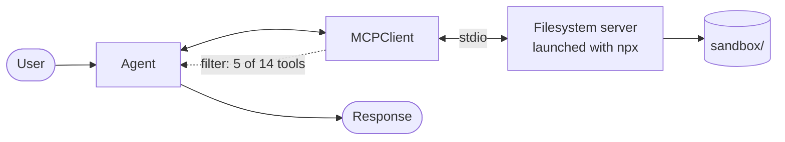

# 02 · Agent with MCP tools

An agent that answers questions about the files in a local folder (`sandbox/`). It defines no
tools of its own: an external **Model Context Protocol** (MCP) server lends them, and the script
launches it and asks it, at startup, what it can do. It shows how to connect an agent to tools
that live outside your code.

> **Difference with `01`:** where the tools come from. There they were `@tool` functions in the
> file; here they are a list returned by an MCP server.

## How it works



| | |
|---|---|
| Pattern | Single agent with external tools (MCP) |
| Strands pieces | `Agent`, `MCPClient`, `list_tools_sync`, `tool_filters`, `OpenAIResponsesModel` |
| Tools | `read_text_file`, `list_directory`, `directory_tree`, `search_files`, `get_file_info`. None of its own |
| MCP server | `@modelcontextprotocol/server-filesystem@2026.8.31` (pinned version) |
| Model | `gpt-5.4-nano` (overridable with `MODEL_ID`) |

**Key ideas**

- **Tools are discovered at startup.** `list_tools_sync()` asks the server what it offers. The
  catalog is not written in the code.
- **Allowlist, not denylist.** The server offers 14 tools and `tool_filters={"allowed": [...]}`
  lets through only the 5 read-only ones. The write tools never reach the model.
- **Everything lives inside `with fs_client:`.** The tools only work while the session is open. If
  you create the agent outside it, it fails with `MCPClientInitializationError` on the first call.

## Setup and running

Requirements: Python 3.10+, **Node.js ≥ 18** (`node --version`) and an `OPENAI_API_KEY`.

```bash
cd strands-agents/02-mcp-agent
python -m venv .venv && .venv/bin/pip install -r requirements.txt
cp .env.example .env          # put your OPENAI_API_KEY in it
.venv/bin/python agent.py     # 'exit' to quit
```

| Variable | Required | Use |
|---|---|---|
| `OPENAI_API_KEY` | Yes | Your OpenAI key |
| `MODEL_ID` | No | Model to use; defaults to `gpt-5.4-nano` |

> **The first start takes a few seconds** while `npx` downloads the server. It has not hung.

## Examples

| You ask | Tool it uses |
|---|---|
| "what files are there?" | `list_directory` |
| "which port does the service listen on?" | `read_text_file` |
| "is there any .json file?" | `search_files` |
| "delete the notes file" | None: it has no write tools |

Excerpt from a real session (the prompts were typed in Spanish and are translated here):

```text
You > which port does the service listen on?
Tool #3: read_text_file
Tool #4: read_text_file
Tool #5: read_text_file

FileBot > The service listens on port 8642.

You > what is the deployment code?
Tool #8: read_text_file

FileBot > The deployment code is KRAKEN-7743.

You > delete the notes file

FileBot > I can't delete it: I only have read access to the files in this environment.
```

**The proof:** `8642` and `KRAKEN-7743` only exist in the files in `sandbox/`, so the agent read
them. In the last turn there is no `Tool #N` line.

## References

- [Strands Agents: MCP tools](https://strandsagents.com/docs/user-guide/concepts/tools/mcp-tools/)
- [Model Context Protocol](https://modelcontextprotocol.io/)
- [Filesystem MCP server](https://github.com/modelcontextprotocol/servers/tree/main/src/filesystem)
- [OpenAI provider in Strands](https://strandsagents.com/docs/user-guide/concepts/model-providers/openai/)
- Files: [`agent.py`](./agent.py) · [`requirements.txt`](./requirements.txt) · [`.env.example`](./.env.example) · [`sandbox/`](./sandbox/)
