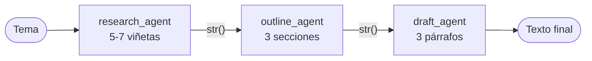

# 03 · Pipeline secuencial de agentes

Tres agentes en fila convierten un tema en un texto: uno investiga, otro organiza y otro redacta.
La salida de cada uno es la entrada del siguiente. Sirve para ver que **componer agentes no
necesita un orquestador**: el encadenado son tres asignaciones de Python.

> **Diferencia con `02`:** no hay herramientas ni MCP. En su lugar hay tres agentes, uno detrás
> de otro.

## Cómo funciona



| | |
|---|---|
| Patrón | Pipeline secuencial, encadenado a mano |
| Piezas de Strands | `Agent`, `OpenAIResponsesModel`, `callback_handler=None`, `agent.messages` |
| Herramientas | Ninguna |
| Modelo | `gpt-5.4-nano` (cambiable con `MODEL_ID`) |

**Ideas clave**

- **Encadenar es asignar.** `notes = str(research_agent(topic))`. El `str()` convierte el
  `AgentResult` en texto para pasárselo a la siguiente etapa.
- **El contrato entre etapas vive en el `system_prompt`.** Es texto sin estructura, la forma más
  frágil. `12-structured-output` lo resuelve.
- **Cada corrida empieza en blanco.** Se vacía `agent.messages` en las tres etapas para que un tema
  no arrastre al anterior.
- **No está fundamentado.** La etapa 1 trabaja de memoria, sin web ni herramientas. No tomes sus
  salidas como hechos.

## Configuración y ejecución

Requisitos: Python 3.10+ y una `OPENAI_API_KEY`. Sin AWS ni Node.js.

```bash
cd strands-agents/03-sequential-pipeline
python -m venv .venv && .venv/bin/pip install -r requirements.txt
cp .env.example .env          # pon tu OPENAI_API_KEY
.venv/bin/python agent.py     # 'exit' para salir
```

| Variable | Obligatoria | Uso |
|---|---|---|
| `OPENAI_API_KEY` | Sí | Tu clave de OpenAI |
| `MODEL_ID` | No | Modelo a usar; por defecto `gpt-5.4-nano` |

> **Unos segundos de silencio por etapa:** el streaming está desactivado. El banner `[N/3]` indica
> en qué etapa va el pipeline.

## Ejemplos

Escribe un tema (`Topic >`) y verás salir las tres etapas. Fragmento real, recortado:

```text
Topic > el impacto de los LLM en la educación

[1/3] research ──►
- Los LLM pueden actuar como “tutor inmediato” que explica conceptos, propone ejercicios...
- La principal tensión pedagógica es entre personalización y veracidad...

[2/3] outline ──►
1. Tutor inmediato y limitaciones
2. Personalización, verificación y evaluación
3. Docencia, equidad y mitigaciones

[3/3] draft ──►
Tutor inmediato y limitaciones
Los LLM funcionan a menudo como un “tutor inmediato” que aclara conceptos...
```

**La prueba:** los encabezados del borrador son exactamente los títulos que inventó la etapa 2 y
que no estaban en las viñetas de la etapa 1. La etapa 3 solo pudo conocerlos por el encadenado.

## Referencias

- [Strands Agents: documentación](https://strandsagents.com/)
- [Patrones multi-agente en Strands](https://strandsagents.com/latest/documentation/docs/user-guide/concepts/multi-agent/multi-agent-patterns/) (las primitivas que este ejemplo no usa a propósito)
- [Proveedor OpenAI en Strands](https://strandsagents.com/latest/documentation/docs/user-guide/concepts/model-providers/openai/)
- Archivos: [`agent.py`](./agent.py) · [`requirements.txt`](./requirements.txt) · [`.env.example`](./.env.example)
