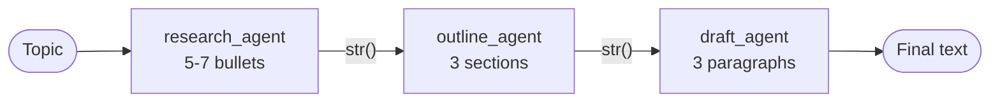

# 03 · Sequential agent pipeline

Three agents in a row turn a topic into a text: one researches, another organizes and another
writes. The output of each one is the input of the next. It shows that **composing agents does not
need an orchestrator**: the chaining is three Python assignments.

> **Difference with `02`:** there are no tools or MCP. Instead there are three agents, one after
> the other.

## How it works



| | |
|---|---|
| Pattern | Sequential pipeline, chained by hand |
| Strands pieces | `Agent`, `OpenAIResponsesModel`, `callback_handler=None`, `agent.messages` |
| Tools | None |
| Model | `gpt-5.4-nano` (overridable with `MODEL_ID`) |

**Key ideas**

- **Chaining is assigning.** `notes = str(research_agent(topic))`. The `str()` turns the
  `AgentResult` into text to hand to the next stage.
- **The contract between stages lives in the `system_prompt`.** It is unstructured text, the most
  fragile form. `12-structured-output` solves it.
- **Every run starts blank.** `agent.messages` is cleared in all three stages so one topic does not
  carry over into the next.
- **It is not grounded.** Stage 1 works from memory, with no web or tools. Do not take its outputs
  as facts.

## Setup and running

Requirements: Python 3.10+ and an `OPENAI_API_KEY`. No AWS or Node.js.

```bash
cd strands-agents/03-sequential-pipeline
python -m venv .venv && .venv/bin/pip install -r requirements.txt
cp .env.example .env          # put your OPENAI_API_KEY in it
.venv/bin/python agent.py     # 'exit' to quit
```

| Variable | Required | Use |
|---|---|---|
| `OPENAI_API_KEY` | Yes | Your OpenAI key |
| `MODEL_ID` | No | Model to use; defaults to `gpt-5.4-nano` |

> **A few seconds of silence per stage:** streaming is turned off. The `[N/3]` banner shows which
> stage the pipeline is on.

## Examples

Type a topic (`Topic >`) and you will see the three stages come out. Real excerpt, trimmed (the
topic was typed in Spanish and the output was in Spanish; both are translated here):

```text
Topic > the impact of LLMs on education

[1/3] research ──►
- LLMs can act as an "instant tutor" that explains concepts, suggests exercises...
- The main pedagogical tension is between personalization and truthfulness...

[2/3] outline ──►
1. Instant tutor and limitations
2. Personalization, verification and assessment
3. Teaching, equity and mitigations

[3/3] draft ──►
Instant tutor and limitations
LLMs often work as an "instant tutor" that clarifies concepts...
```

**The proof:** the draft's headings are exactly the titles that stage 2 made up and that were not
in stage 1's bullets. Stage 3 could only know them through the chaining.

## References

- [Strands Agents: documentation](https://strandsagents.com/)
- [Multi-agent patterns in Strands](https://strandsagents.com/latest/documentation/docs/user-guide/concepts/multi-agent/multi-agent-patterns/) (the primitives this example deliberately does not use)
- [OpenAI provider in Strands](https://strandsagents.com/latest/documentation/docs/user-guide/concepts/model-providers/openai/)
- Files: [`agent.py`](./agent.py) · [`requirements.txt`](./requirements.txt) · [`.env.example`](./.env.example)
