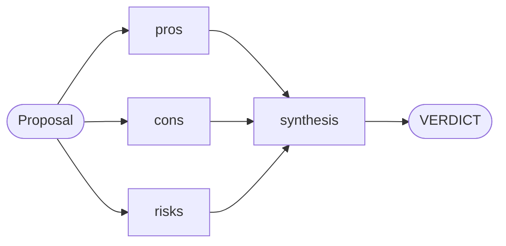

# 04 · Parallel agent fan-out (fan-out / fan-in)

Three agents analyze **the same** proposal at once (pros, cons and risks). A fourth waits for all
three and gives a verdict. It shows how to run agents in parallel when they do not depend on each
other: the total time approaches that of the slowest branch instead of the sum.

> **Difference with `03`:** the topology. Where there was a line, there is now a fan with
> `asyncio.gather`.

## How it works



| | |
|---|---|
| Pattern | Fan-out / fan-in: 3 parallel branches and 1 aggregator |
| Strands pieces | `Agent`, `Agent.invoke_async`, `OpenAIResponsesModel`, `callback_handler=None` |
| Tools | None |
| Model | `gpt-6-luna` (overridable with `MODEL_ID`) |

**Key ideas**

- **The parallelism comes from `asyncio`, not Strands.** The whole fan is an `asyncio.gather` over
  `invoke_async`, on a single thread.
- **You parallelize what does not need each other.** In `03` each stage waited for the previous
  one. Here no branch needs another.
- **One agent per branch.** Reusing the same `Agent` instance in two branches at once raises an
  error. That is why `branch()` creates one instance per branch.
- **No streaming, by necessity.** With three responses at once, the console would get mixed up.

## Setup and running

Requirements: Python 3.10+ and an `OPENAI_API_KEY`. It adds no dependencies: `asyncio` is in the
standard library.

```bash
cd strands-agents/04-parallel-fanout
python -m venv .venv && .venv/bin/pip install -r requirements.txt
cp .env.example .env          # put your OPENAI_API_KEY in it
.venv/bin/python agent.py     # 'exit' to quit
```

| Variable | Required | Use |
|---|---|---|
| `OPENAI_API_KEY` | Yes | Your OpenAI key |
| `MODEL_ID` | No | Model to use; defaults to `gpt-6-luna` |

> **The timing lines come out in the order each branch finishes**, not in the order they are
> declared. That jumbled order shows they ran at the same time.

## Examples

Type a proposal (`Proposal >`). Real excerpt (the proposal was typed in Spanish and the output was
in Spanish; both are translated here):

```text
Proposal > adopt the 4-day work week

[fan-out] lanzando 3 analistas en paralelo...
  risks  ──►   1.4s
  cons   ──►   1.7s
  pros   ──►   1.7s
  total:   1.7s  (en secuencia habrian sido 4.9s)

[fan-in] synthesis ──►
VERDICT: conditional
- Potential benefits: higher productivity/focus and possibly lower absenteeism... (P1, P2)
- Operational feasibility depends on the context... (C1, R2)
```

**The proof:** the clock. On another proposal in the same session, the total was **4.4 s** when
the branches added up to **9.9 s**. Also, the verdict cites labels (`P1`, `C1`, `R2`) that only
exist in the branch outputs.

## References

- [`asyncio.gather` in the Python documentation](https://docs.python.org/3/library/asyncio-task.html#asyncio.gather)
- [Multi-agent patterns in Strands](https://strandsagents.com/latest/documentation/docs/user-guide/concepts/multi-agent/multi-agent-patterns/) (`07-agent-graph` repeats this fan with `GraphBuilder`)
- [OpenAI provider in Strands](https://strandsagents.com/latest/documentation/docs/user-guide/concepts/model-providers/openai/)
- Files: [`agent.py`](./agent.py) · [`requirements.txt`](./requirements.txt) · [`.env.example`](./.env.example)
