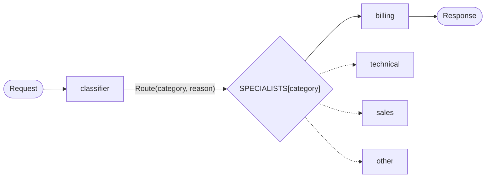

# 05 · Agent router (classify and dispatch)

A support agent that first **classifies** the request (billing, technical, sales or other) and
then hands it to **a single** specialist. The classification comes out as a typed, validated
object, not free text. It shows how to pick a request's route at a fixed cost: two model calls,
whether there are 4 destinations or 40.

> **Difference with `04`:** instead of running all the branches, it decides which one to run and
> only that one runs.

## How it works



| | |
|---|---|
| Pattern | Router: the model classifies and the code dispatches |
| Strands pieces | `Agent`, `structured_output_model=`, `AgentResult.structured_output`, `OpenAIResponsesModel` |
| Tools | None written by hand |
| Model | `gpt-6-luna` (overridable with `MODEL_ID`) |

**Key ideas**

- **A router is a structured output and a `dict`.** `route = classifier(..., structured_output_model=Route).structured_output`
  and then `SPECIALISTS[route.category](request)`.
- **The `Enum` closes the destinations.** The model cannot invent a fifth category. If it tries,
  Pydantic rejects it and the SDK asks it to correct itself.
- **The criterion lives in `Field(description=...)`.** To tune the classification you edit the
  description; you do not add an `if`.
- **Beware of `str(result)`.** On a call with a schema it returns the JSON. To get the object you
  have to read `.structured_output`.

## Setup and running

Requirements: Python 3.10+ and an `OPENAI_API_KEY`. It adds `pydantic` to `requirements.txt` (it
already came with `strands-agents`).

```bash
cd strands-agents/05-router-agent
python -m venv .venv && .venv/bin/pip install -r requirements.txt
cp .env.example .env          # put your OPENAI_API_KEY in it
.venv/bin/python agent.py     # 'exit' to quit
```

| Variable | Required | Use |
|---|---|---|
| `OPENAI_API_KEY` | Yes | Your OpenAI key |
| `MODEL_ID` | No | Model to use; defaults to `gpt-6-luna` |

> **The `[router]` line comes out before the response.** That way, if something goes wrong, you
> know whether the classification or the specialist failed.

## Examples

| You ask | Route |
|---|---|
| "you charged me twice for the March invoice" | `billing` |
| "the app crashes on open since the last update" | `technical` |
| "how much does it cost to upgrade to the team plan?" | `sales` |
| "do you work on public holidays?" | `other` |

Real excerpt (the borderline case: it says "error" but it is about billing; the request was typed
in Spanish and the output was in Spanish, both translated here):

```text
Request > I was overcharged because of an error in the app

[router] billing ──► Overcharge due to an app error; request an adjustment/refund
I'm sorry about the error. To review it, I need: date and time of the charge, amount, currency...
```

**The proof:** after one request, the histories are left at `classifier 3`, `billing 2` and
`technical/sales/other 0`. Only one branch ran. The `reason` is written by the model: it is not in
`agent.py`.

## References

- [Structured output in Strands](https://strandsagents.com/latest/documentation/docs/user-guide/concepts/agents/structured-output/)
- [Pydantic](https://docs.pydantic.dev/latest/)
- [Multi-agent patterns in Strands](https://strandsagents.com/latest/documentation/docs/user-guide/concepts/multi-agent/multi-agent-patterns/) (`07-agent-graph` repeats this triage with `GraphBuilder`)
- [OpenAI provider in Strands](https://strandsagents.com/latest/documentation/docs/user-guide/concepts/model-providers/openai/)
- Files: [`agent.py`](./agent.py) · [`requirements.txt`](./requirements.txt) · [`.env.example`](./.env.example)
