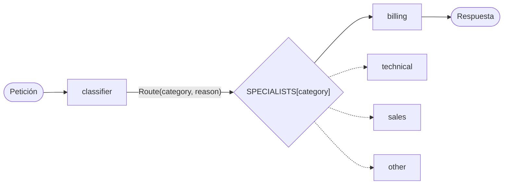

# 05 · Router de agentes (clasificar y despachar)

Un agente de soporte que primero **clasifica** la petición (facturación, técnico, ventas u otro) y
después la pasa a **un único** especialista. La clasificación sale como un objeto tipado y
validado, no como texto libre. Sirve para ver cómo elegir la ruta de una petición con un coste
fijo: dos llamadas al modelo, haya 4 destinos o 40.

> **Diferencia con `04`:** en lugar de ejecutar todas las ramas, se decide cuál ejecutar y corre
> solo una.

## Cómo funciona



| | |
|---|---|
| Patrón | Router: el modelo clasifica y el código despacha |
| Piezas de Strands | `Agent`, `structured_output_model=`, `AgentResult.structured_output`, `OpenAIResponsesModel` |
| Herramientas | Ninguna escrita a mano |
| Modelo | `gpt-5.4-nano` (cambiable con `MODEL_ID`) |

**Ideas clave**

- **Un router es una salida estructurada y un `dict`.** `route = classifier(..., structured_output_model=Route).structured_output`
  y luego `SPECIALISTS[route.category](request)`.
- **El `Enum` cierra los destinos.** El modelo no puede inventar una quinta categoría. Si lo
  intenta, Pydantic lo rechaza y el SDK le pide que corrija.
- **El criterio vive en `Field(description=...)`.** Para ajustar la clasificación se edita la
  descripción, no se añade un `if`.
- **Cuidado con `str(result)`.** En una llamada con esquema devuelve el JSON. Para obtener el
  objeto hay que leer `.structured_output`.

## Configuración y ejecución

Requisitos: Python 3.10+ y una `OPENAI_API_KEY`. Añade `pydantic` al `requirements.txt` (ya venía
con `strands-agents`).

```bash
cd strands-agents/05-router-agent
python -m venv .venv && .venv/bin/pip install -r requirements.txt
cp .env.example .env          # pon tu OPENAI_API_KEY
.venv/bin/python agent.py     # 'exit' para salir
```

| Variable | Obligatoria | Uso |
|---|---|---|
| `OPENAI_API_KEY` | Sí | Tu clave de OpenAI |
| `MODEL_ID` | No | Modelo a usar; por defecto `gpt-5.4-nano` |

> **La línea `[router]` sale antes que la respuesta.** Así, si algo sale mal, sabes si falló la
> clasificación o el especialista.

## Ejemplos

| Pides | Ruta |
|---|---|
| "me habéis cobrado dos veces la factura de marzo" | `billing` |
| "la app peta al abrir desde la última actualización" | `technical` |
| "¿cuánto cuesta subir al plan de equipos?" | `sales` |
| "¿trabajáis los festivos?" | `other` |

Fragmento real (el caso frontera: dice "error" pero es de facturación):

```text
Request > me han cobrado de más por culpa de un error de la app

[router] billing ──► Cobro excesivo por error en la app; solicitar ajuste/reembolso
Lamento el error. Para revisarlo, necesito: fecha y hora del cobro, importe, moneda...
```

**La prueba:** tras una petición, los historiales quedan en `classifier 3`, `billing 2` y
`technical/sales/other 0`. Solo corrió una rama. El `reason` lo escribe el modelo: no está en
`agent.py`.

## Referencias

- [Salida estructurada en Strands](https://strandsagents.com/latest/documentation/docs/user-guide/concepts/agents/structured-output/)
- [Pydantic](https://docs.pydantic.dev/latest/)
- [Patrones multi-agente en Strands](https://strandsagents.com/latest/documentation/docs/user-guide/concepts/multi-agent/multi-agent-patterns/) (`07-agent-graph` repite este triage con `GraphBuilder`)
- [Proveedor OpenAI en Strands](https://strandsagents.com/latest/documentation/docs/user-guide/concepts/model-providers/openai/)
- Archivos: [`agent.py`](./agent.py) · [`requirements.txt`](./requirements.txt) · [`.env.example`](./.env.example)
