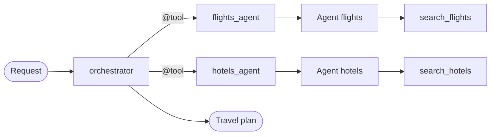

# 06 · Agents as tools

A travel orchestrator with two tools that are really **agents**: one searches flights and the
other hotels, each with its own data tool. The orchestrator decides whom to call, in what order and
how many times. It shows hierarchical composition without any multi-agent primitive: an
agent-tool is a `@tool` function that calls an `Agent`.

> **Difference with `05`:** the line that dispatches is gone. Now the model decides, not the code.

## How it works



| | |
|---|---|
| Pattern | Agents as tools (2-level hierarchy) |
| Strands pieces | `Agent`, `@tool`, `OpenAIResponsesModel`, `callback_handler=None` |
| Tools | 4: `flights_agent`, `hotels_agent` (wrap agents), `search_flights`, `search_hotels` (read data) |
| Model | `gpt-6-luna` (overridable with `MODEL_ID`) |

**Key ideas**

- **An agent-tool is three lines.** A `@tool` function that calls the sub-agent and returns
  `str(...)`. To the orchestrator it is the same as any other tool.
- **The docstring is the dispatch criterion.** If the orchestrator picks wrong, you fix the
  docstring; you do not add an `if`.
- **Not delegating is also an option.** Given a general question, the orchestrator answers on its
  own.
- **The cost stops being fixed.** Depending on what the model decides, a turn costs 1, 4, 6 or 7
  calls. Strands also offers `Agent.as_tool()`; here the wrapper is written by hand so the
  mechanism is visible.

## Setup and running

Requirements: Python 3.10+ and an `OPENAI_API_KEY`. No AWS or Node.js.

```bash
cd strands-agents/06-agents-as-tools
python -m venv .venv && .venv/bin/pip install -r requirements.txt
cp .env.example .env          # put your OPENAI_API_KEY in it
.venv/bin/python agent.py     # 'exit' to quit
```

| Variable | Required | Use |
|---|---|---|
| `OPENAI_API_KEY` | Yes | Your OpenAI key |
| `MODEL_ID` | No | Model to use; defaults to `gpt-6-luna` |

> **The `[tool] … ──►` lines show the delegation as it happens.** If you see none, the
> orchestrator answered on its own.

## Examples

| You ask | Specialists called |
|---|---|
| "3 days in Lisbon, I need a flight and a hotel" | `flights_agent` + `hotels_agent` |
| "where do I sleep in Porto?" | `hotels_agent` |
| "do I need a passport to travel within the EU?" | None |
| "I want to fly to Tokyo next week" | `flights_agent` (it is not in the catalog and says so) |

Real excerpt (first request; it was typed in Spanish and the output was in Spanish, both
translated here):

```text
Trip >   [tool] flights_agent ──►
  [tool] hotels_agent ──►

**Flights (flights specialist):** For Lisbon, I found flight **IB-4417 (08:05-09:25) for 412 EUR**.

**Hotel (hotels specialist):** I found **"Casa Kraken, Alfama"** ( **94 EUR/night** ) for Lisbon.
```

**The proof:** `IB-4417` only exists in a Python `dict`. To reach the final plan it went through
four hops (`search_flights` → `flights` → `flights_agent` → `orchestrator`). The data is made up
on purpose.

## References

- [Agents as tools in Strands](https://strandsagents.com/latest/documentation/docs/user-guide/concepts/multi-agent/agents-as-tools/)
- [Python tools: `@tool`](https://strandsagents.com/latest/documentation/docs/user-guide/concepts/tools/python-tools/)
- [Multi-agent patterns in Strands](https://strandsagents.com/latest/documentation/docs/user-guide/concepts/multi-agent/multi-agent-patterns/) (`07-agent-graph` and `08-agent-swarm` are the framework's alternatives)
- [OpenAI provider in Strands](https://strandsagents.com/latest/documentation/docs/user-guide/concepts/model-providers/openai/)
- Files: [`agent.py`](./agent.py) · [`requirements.txt`](./requirements.txt) · [`.env.example`](./.env.example)
