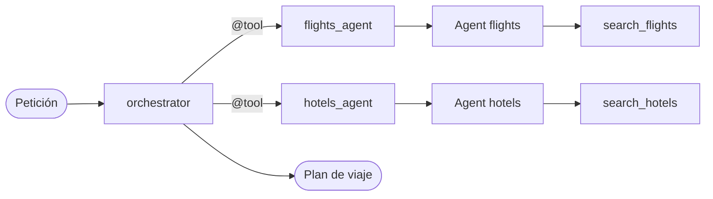

# 06 · Agentes como herramientas

Un orquestador de viajes con dos herramientas que en realidad son **agentes**: uno busca vuelos y
otro hoteles, cada uno con su propia herramienta de datos. El orquestador decide a quién llamar, en
qué orden y cuántas veces. Sirve para ver la composición jerárquica sin ninguna primitiva
multi-agente: un agente-herramienta es una función `@tool` que llama a un `Agent`.

> **Diferencia con `05`:** desaparece la línea que despacha. Ahora decide el modelo, no el código.

## Cómo funciona



| | |
|---|---|
| Patrón | Agentes como herramientas (jerarquía de 2 niveles) |
| Piezas de Strands | `Agent`, `@tool`, `OpenAIResponsesModel`, `callback_handler=None` |
| Herramientas | 4: `flights_agent`, `hotels_agent` (envuelven agentes), `search_flights`, `search_hotels` (leen datos) |
| Modelo | `gpt-5.4-nano` (cambiable con `MODEL_ID`) |

**Ideas clave**

- **Un agente-herramienta son tres líneas.** Una función `@tool` que llama al sub-agente y
  devuelve `str(...)`. Para el orquestador es igual que cualquier otra tool.
- **El docstring es el criterio de despacho.** Si el orquestador elige mal, se arregla el
  docstring, no se añade un `if`.
- **No delegar también es una opción.** Ante una pregunta general, el orquestador contesta él solo.
- **El coste deja de ser fijo.** Según decida el modelo, un turno cuesta 1, 4, 6 o 7 llamadas.
  Strands también ofrece `Agent.as_tool()`; aquí el envoltorio se escribe a mano para que se vea
  el mecanismo.

## Configuración y ejecución

Requisitos: Python 3.10+ y una `OPENAI_API_KEY`. Sin AWS ni Node.js.

```bash
cd strands-agents/06-agents-as-tools
python -m venv .venv && .venv/bin/pip install -r requirements.txt
cp .env.example .env          # pon tu OPENAI_API_KEY
.venv/bin/python agent.py     # 'exit' para salir
```

| Variable | Obligatoria | Uso |
|---|---|---|
| `OPENAI_API_KEY` | Sí | Tu clave de OpenAI |
| `MODEL_ID` | No | Modelo a usar; por defecto `gpt-5.4-nano` |

> **Las líneas `[tool] … ──►` muestran la delegación en el momento en que ocurre.** Si no ves
> ninguna, el orquestador contestó él solo.

## Ejemplos

| Pides | Especialistas llamados |
|---|---|
| "3 días en Lisboa, necesito vuelo y hotel" | `flights_agent` + `hotels_agent` |
| "¿dónde duermo en Oporto?" | `hotels_agent` |
| "¿necesito pasaporte para viajar dentro de la UE?" | Ninguno |
| "quiero volar a Tokio la semana que viene" | `flights_agent` (no está en el catálogo y lo dice) |

Fragmento real (primera petición):

```text
Trip >   [tool] flights_agent ──►
  [tool] hotels_agent ──►

**Vuelos (especialista de vuelos):** Para Lisboa, encontré el vuelo **IB-4417 (08:05-09:25) por 412 EUR**.

**Hotel (especialista de hoteles):** Encontré **“Casa Kraken, Alfama”** ( **94 EUR/noche** ) para Lisboa.
```

**La prueba:** `IB-4417` solo existe en un `dict` de Python. Para llegar al plan final pasó por
cuatro saltos (`search_flights` → `flights` → `flights_agent` → `orchestrator`). Los datos son
inventados a propósito.

## Referencias

- [Agentes como herramientas en Strands](https://strandsagents.com/latest/documentation/docs/user-guide/concepts/multi-agent/agents-as-tools/)
- [Herramientas en Python: `@tool`](https://strandsagents.com/latest/documentation/docs/user-guide/concepts/tools/python-tools/)
- [Patrones multi-agente en Strands](https://strandsagents.com/latest/documentation/docs/user-guide/concepts/multi-agent/multi-agent-patterns/) (`07-agent-graph` y `08-agent-swarm` son las alternativas del framework)
- [Proveedor OpenAI en Strands](https://strandsagents.com/latest/documentation/docs/user-guide/concepts/model-providers/openai/)
- Archivos: [`agent.py`](./agent.py) · [`requirements.txt`](./requirements.txt) · [`.env.example`](./.env.example)
