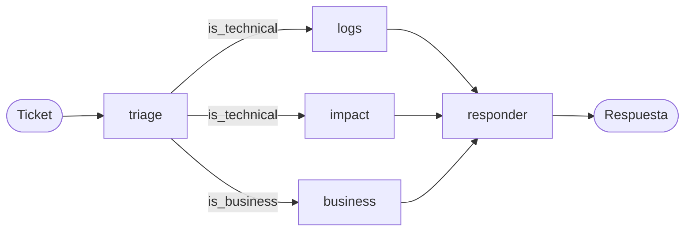

# 07 · Grafo de agentes

Un mostrador de soporte con cinco agentes conectados por **seis aristas declaradas antes de que
corra nada**. `triage` clasifica el ticket y el grafo sigue la rama técnica (`logs` e `impact` en
paralelo) o la de negocio (`business`); `responder` escribe la respuesta final. Sirve para ver una
arquitectura multi-agente que se lee como un diagrama y que recorre el framework, no tu código.

> **Diferencia con `06`:** ninguna línea de Python relaciona dos agentes en tiempo de ejecución.
> Las conexiones se declaran con `GraphBuilder` y las recorre el `Graph`.

## Cómo funciona



| | |
|---|---|
| Patrón | Grafo de agentes con aristas condicionales |
| Piezas de Strands | `GraphBuilder`, `add_node`, `add_edge(condition=...)`, `set_entry_point`, `set_max_node_executions`, `GraphResult` |
| Herramientas | Ninguna: los cinco nodos son texto a texto |
| Modelo | `gpt-5.4-nano` (cambiable con `MODEL_ID`) |

**Ideas clave**

- **La topología es un dato.** Cinco nodos y seis aristas en un bloque consecutivo de
  `agent.py`. Cada rama tiene un coste que se cuenta antes de ejecutar: 4 llamadas (técnica) o 3
  (negocio).
- **Una condición es una función que lee otro nodo.** `is_technical` busca `"TECHNICAL"` en la
  salida de `triage`. Es más frágil que el `Route` validado de `05`, e `is_business` es su `not`
  para que siempre salga exactamente una rama.
- **Cada nodo recibe el ticket original y la salida de sus dependencias**, etiquetada con el
  `node_id` que la produjo. `logs` e `impact` corren en paralelo sin una sola línea de `asyncio`.
- **Cuidado con `str(result)`.** Concatena la salida de todos los nodos, veredicto interno
  incluido. La respuesta al cliente se lee de un nodo concreto: `result.results["responder"]`.

## Configuración y ejecución

Requisitos: Python 3.10+ y una `OPENAI_API_KEY`. Mismas dependencias que `06`.

```bash
cd strands-agents/07-agent-graph
python -m venv .venv && .venv/bin/pip install -r requirements.txt
cp .env.example .env          # pon tu OPENAI_API_KEY
.venv/bin/python agent.py     # 'exit' para salir
```

| Variable | Obligatoria | Uso |
|---|---|---|
| `OPENAI_API_KEY` | Sí | Tu clave de OpenAI |
| `MODEL_ID` | No | Modelo a usar; por defecto `gpt-5.4-nano` |

> **La línea `[graph]` sale después de la corrida, no durante.** El recorrido lo hace el `Graph` y
> lo cuenta al terminar en `result.execution_order`.

## Ejemplos

| Pides | Recorrido |
|---|---|
| "La exportación a CSV falla con error 500 desde ayer" | `triage → logs + impact → responder` (4 llamadas) |
| "Me habéis cobrado dos veces la cuota de este mes" | `triage → business → responder` (3 llamadas) |

Fragmento real contra `gpt-5.4-nano`:

```text
Ticket > La exportación a CSV falla con error 500 desde ayer
[graph] triage ──► logs ──► impact ──► responder
Desde ayer la exportación a CSV falla para los usuarios con error HTTP 500 (impacto completo)...

Ticket > Me habéis cobrado dos veces la cuota de este mes
[graph] triage ──► business ──► responder
Hola, gracias por avisar. Para revisar el doble cobro, necesito por favor: fecha y hora de los cargos...
```

**La prueba:** la traza `[graph]` la devuelve el propio `Graph` en `execution_order`. En el segundo
ticket `logs` e `impact` no aparecen y sus historiales quedan con 0 mensajes. El orden entre `logs`
e `impact` puede variar: corren a la vez.

## Referencias

- [Grafos de agentes en Strands](https://strandsagents.com/latest/documentation/docs/user-guide/concepts/multi-agent/graph/)
- [Patrones multi-agente en Strands](https://strandsagents.com/latest/documentation/docs/user-guide/concepts/multi-agent/multi-agent-patterns/) (`08-agent-swarm` es la alternativa sin topología)
- [Proveedor OpenAI en Strands](https://strandsagents.com/latest/documentation/docs/user-guide/concepts/model-providers/openai/)
- Archivos: [`agent.py`](./agent.py) · [`requirements.txt`](./requirements.txt) · [`.env.example`](./.env.example)
