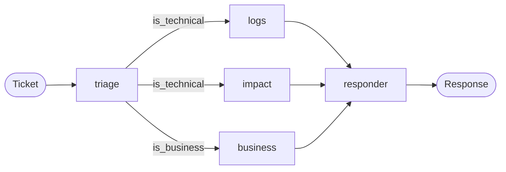

# 07 · Agent graph

A support desk with five agents connected by **six edges declared before anything runs**. `triage`
classifies the ticket and the graph follows either the technical branch (`logs` and `impact` in
parallel) or the business one (`business`); `responder` writes the final reply. It shows a
multi-agent architecture that reads like a diagram and is walked by the framework, not by your
code.

> **Difference with `06`:** no line of Python relates two agents at runtime. The connections are
> declared with `GraphBuilder` and walked by the `Graph`.

## How it works



| | |
|---|---|
| Pattern | Agent graph with conditional edges |
| Strands pieces | `GraphBuilder`, `add_node`, `add_edge(condition=...)`, `set_entry_point`, `set_max_node_executions`, `GraphResult` |
| Tools | None: all five nodes are text in, text out |
| Model | `gpt-6-luna` (overridable with `MODEL_ID`) |

**Key ideas**

- **The topology is data.** Five nodes and six edges in one consecutive block of `agent.py`. Each
  branch has a cost you can count before running: 4 calls (technical) or 3 (business).
- **A condition is a function that reads another node.** `is_technical` looks for `"TECHNICAL"` in
  the output of `triage`. It is more fragile than the validated `Route` of `05`, and `is_business`
  is its `not` so that exactly one branch always fires.
- **Each node receives the original ticket and the output of its dependencies**, labeled with the
  `node_id` that produced it. `logs` and `impact` run in parallel without a single line of
  `asyncio`.
- **Beware of `str(result)`.** It concatenates the output of all the nodes, internal verdict
  included. The customer reply is read from a specific node: `result.results["responder"]`.

## Setup and running

Requirements: Python 3.10+ and an `OPENAI_API_KEY`. Same dependencies as `06`.

```bash
cd strands-agents/07-agent-graph
python -m venv .venv && .venv/bin/pip install -r requirements.txt
cp .env.example .env          # put your OPENAI_API_KEY in it
.venv/bin/python agent.py     # 'exit' to quit
```

| Variable | Required | Use |
|---|---|---|
| `OPENAI_API_KEY` | Yes | Your OpenAI key |
| `MODEL_ID` | No | Model to use; defaults to `gpt-6-luna` |

> **The `[graph]` line comes out after the run, not during it.** The `Graph` does the walk and
> reports it at the end in `result.execution_order`.

## Examples

| You ask | Path |
|---|---|
| "CSV export has been failing with a 500 error since yesterday" | `triage → logs + impact → responder` (4 calls) |
| "You charged me twice for this month's fee" | `triage → business → responder` (3 calls) |

Real excerpt against `gpt-5.4-nano` (the tickets were typed in Spanish and the replies were in
Spanish; both are translated here):

```text
Ticket > CSV export has been failing with a 500 error since yesterday
[graph] triage ──► logs ──► impact ──► responder
Since yesterday, CSV export has been failing for users with an HTTP 500 error (full impact)...

Ticket > You charged me twice for this month's fee
[graph] triage ──► business ──► responder
Hi, thanks for letting us know. To look into the double charge, please send me: date and time of the charges...
```

**The proof:** the `[graph]` trace is returned by the `Graph` itself in `execution_order`. On the
second ticket `logs` and `impact` do not appear and their histories stay at 0 messages. The order
between `logs` and `impact` may vary: they run at the same time.

## References

- [Agent graphs in Strands](https://strandsagents.com/latest/documentation/docs/user-guide/concepts/multi-agent/graph/)
- [Multi-agent patterns in Strands](https://strandsagents.com/latest/documentation/docs/user-guide/concepts/multi-agent/multi-agent-patterns/) (`08-agent-swarm` is the alternative with no topology)
- [OpenAI provider in Strands](https://strandsagents.com/latest/documentation/docs/user-guide/concepts/model-providers/openai/)
- Files: [`agent.py`](./agent.py) · [`requirements.txt`](./requirements.txt) · [`.env.example`](./.env.example)
