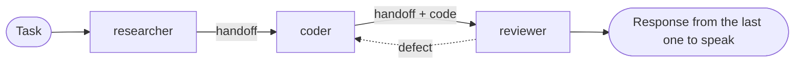

# 08 · Agent swarm

A small development team of three agents (`researcher`, `coder`, `reviewer`) that hand control to
each other to write a Python function. There is no orchestrator and no connections: each agent
decides who goes next. It shows coordination with no central control, where the reviewer can send
the work back to the coder, something the graph in `07` cannot do.

> **Difference with `07`:** the edges are gone. The architecture is a list of agents and a few
> limits; the agents themselves decide the path while they run.

## How it works



| | |
|---|---|
| Pattern | Swarm: autonomous peers that hand control to each other |
| Strands pieces | `Swarm`, `Agent(name=, description=)`, `swarm.stream_async()`, `SwarmResult`, the injected `handoff_to_agent` tool |
| Tools | None written by hand: the `Swarm` injects `handoff_to_agent` into each agent |
| Model | `gpt-6-luna` (overridable with `MODEL_ID`) |

**Key ideas**

- **`description=` is the routing criterion.** The `Swarm` shows it to each agent in the list of
  available teammates; it is the only thing they use to choose who gets the turn.
- **The swarm ends when an agent goes quiet.** If it does not call `handoff_to_agent`, the task is
  considered finished. The stop condition lives in `REVIEWER_PROMPT`, not in the code.
- **The limits are mandatory.** With no orchestrator, `max_iterations=6` and the repeated-handoff
  detector are the only things that bound the run: at most 12 calls. A `failed` status means a
  limit cut it short.
- **The handoff does not carry the previous output.** Only the message and the `context` the agent
  attaches travel along; that is why `CODER_PROMPT` demands pasting the whole function into the
  handoff.

## Setup and running

Requirements: Python 3.10+ and an `OPENAI_API_KEY`. Same dependencies as `07`.

```bash
cd strands-agents/08-agent-swarm
python -m venv .venv && .venv/bin/pip install -r requirements.txt
cp .env.example .env          # put your OPENAI_API_KEY in it
.venv/bin/python agent.py     # 'exit' to quit
```

| Variable | Required | Use |
|---|---|---|
| `OPENAI_API_KEY` | Yes | Your OpenAI key |
| `MODEL_ID` | No | Model to use; defaults to `gpt-6-luna` |

> **Here the trace comes out during the run.** The reason for each handoff only exists in the
> stream's `multiagent_handoff` event, not in the final result.

## Examples

| You ask | Actual path |
|---|---|
| "a function that groups a list of dicts by a key, where some are missing it" | `researcher → coder → reviewer → coder → reviewer` (5 turns) |
| "a function that parses a duration like '1h30m' into seconds" | `researcher → coder → reviewer` (3 turns) |

Real excerpt against `gpt-5.4-nano` (first task; it was typed in Spanish and the final answer was
in Spanish, both translated here; the `pensando...` lines are printed by `agent.py` as-is):

```text
[researcher] pensando...
  researcher ──► coder: Need implement function to group list of dicts by a key when some dicts may miss it.
[coder] pensando...
  coder ──► reviewer: Implement this function: def group_dicts_by_key(items, key, default_bucket=None): ...
[reviewer] pensando...
  reviewer ──► coder: Defect: ... unhashable values for item[key] will raise TypeError ... Please fix whole function.
[coder] pensando...
  coder ──► reviewer: Defect noted: handle unhashable values ... Please review this whole function.
[reviewer] pensando...

[swarm] researcher ──► coder ──► reviewer ──► coder ──► reviewer  (completed)
✅ **Approved.** It keeps the `default_bucket` bucket via `setdefault`...
```

**The proof:** `coder` and `reviewer` appear twice in `node_history`, a cycle that no line of
`agent.py` asked for. The code `coder` writes is never run: the "Approved" is another LLM's
opinion, not proof that the function works.

## References

- [Swarm in Strands](https://strandsagents.com/latest/documentation/docs/user-guide/concepts/multi-agent/swarm/)
- [Multi-agent patterns in Strands](https://strandsagents.com/latest/documentation/docs/user-guide/concepts/multi-agent/multi-agent-patterns/) (`07-agent-graph` is the alternative with a fixed topology)
- [OpenAI provider in Strands](https://strandsagents.com/latest/documentation/docs/user-guide/concepts/model-providers/openai/)
- Files: [`agent.py`](./agent.py) · [`requirements.txt`](./requirements.txt) · [`.env.example`](./.env.example)
