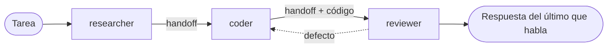

# 08 · Enjambre de agentes

Un pequeño equipo de desarrollo de tres agentes (`researcher`, `coder`, `reviewer`) que se pasan
el control entre ellos para escribir una función Python. No hay orquestador ni conexiones: cada
agente decide a quién le toca después. Sirve para ver una coordinación sin control central, donde
el revisor puede devolver el trabajo al coder, algo que el grafo de `07` no puede hacer.

> **Diferencia con `07`:** desaparecen las aristas. La arquitectura es una lista de agentes y unos
> topes; el recorrido lo deciden los propios agentes mientras corren.

## Cómo funciona



| | |
|---|---|
| Patrón | Enjambre: pares autónomos que se traspasan el control |
| Piezas de Strands | `Swarm`, `Agent(name=, description=)`, `swarm.stream_async()`, `SwarmResult`, la tool inyectada `handoff_to_agent` |
| Herramientas | Ninguna escrita a mano: el `Swarm` inyecta `handoff_to_agent` en cada agente |
| Modelo | `gpt-5.4-nano` (cambiable con `MODEL_ID`) |

**Ideas clave**

- **`description=` es el criterio de enrutado.** El `Swarm` la muestra a cada agente en la lista
  de compañeros disponibles; es lo único con lo que eligen a quién pasar el turno.
- **El swarm termina cuando un agente se calla.** Si no llama a `handoff_to_agent`, la tarea se da
  por acabada. La condición de parada vive en `REVIEWER_PROMPT`, no en el código.
- **Los topes son obligatorios.** Sin orquestador, `max_iterations=6` y el detector de traspasos
  repetidos son lo único que acota la corrida: como mucho 12 llamadas. Un estado `failed` significa
  que un tope la cortó.
- **El traspaso no lleva la salida anterior.** Solo viaja el mensaje y el `context` que el agente
  adjunta; por eso `CODER_PROMPT` exige pegar la función entera en el traspaso.

## Configuración y ejecución

Requisitos: Python 3.10+ y una `OPENAI_API_KEY`. Mismas dependencias que `07`.

```bash
cd strands-agents/08-agent-swarm
python -m venv .venv && .venv/bin/pip install -r requirements.txt
cp .env.example .env          # pon tu OPENAI_API_KEY
.venv/bin/python agent.py     # 'exit' para salir
```

| Variable | Obligatoria | Uso |
|---|---|---|
| `OPENAI_API_KEY` | Sí | Tu clave de OpenAI |
| `MODEL_ID` | No | Modelo a usar; por defecto `gpt-5.4-nano` |

> **Aquí la traza sale durante la corrida.** El motivo de cada traspaso solo existe en el evento
> `multiagent_handoff` del stream, no en el resultado final.

## Ejemplos

| Pides | Recorrido real |
|---|---|
| "una función que agrupe una lista de diccionarios por una clave, donde a algunos les falta" | `researcher → coder → reviewer → coder → reviewer` (5 turnos) |
| "una función que parsee una duración como '1h30m' a segundos" | `researcher → coder → reviewer` (3 turnos) |

Fragmento real contra `gpt-5.4-nano` (primera tarea):

```text
[researcher] pensando...
  researcher ──► coder: Need implement function to group list of dicts by a key when some dicts may miss it.
[coder] pensando...
  coder ──► reviewer: Implement this function: def group_dicts_by_key(items, key, default_bucket=None): ...
[reviewer] pensando...
  reviewer ──► coder: Defect: ... unhashable values for item[key] will raise TypeError ... Please fix whole function.
[coder] pensando...
  coder ──► reviewer: Defect noted: handle unhashable values ... Please review this whole function.
[reviewer] pensando...

[swarm] researcher ──► coder ──► reviewer ──► coder ──► reviewer  (completed)
✅ **Aprobado.** Mantiene el bucket `default_bucket` vía `setdefault`...
```

**La prueba:** `coder` y `reviewer` aparecen dos veces en `node_history`, un ciclo que ninguna línea
de `agent.py` pidió. El código que escribe `coder` nunca se ejecuta: el "Aprobado" es la opinión de
otro LLM, no una prueba de que la función funcione.

## Referencias

- [Swarm en Strands](https://strandsagents.com/latest/documentation/docs/user-guide/concepts/multi-agent/swarm/)
- [Patrones multi-agente en Strands](https://strandsagents.com/latest/documentation/docs/user-guide/concepts/multi-agent/multi-agent-patterns/) (`07-agent-graph` es la alternativa con topología fija)
- [Proveedor OpenAI en Strands](https://strandsagents.com/latest/documentation/docs/user-guide/concepts/model-providers/openai/)
- Archivos: [`agent.py`](./agent.py) · [`requirements.txt`](./requirements.txt) · [`.env.example`](./.env.example)
