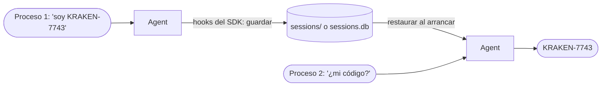

# 09 · Agente con sesión persistente

Mnemo es un asistente de un solo agente, sin herramientas, cuya conversación **sobrevive al
reinicio del proceso**. Le dices un dato en una corrida, cierras el programa, y en la siguiente te
lo recuerda. Sirve para ver cómo Strands guarda y restaura el historial sin ningún `save()` ni
`load()`, y cómo cambiar de almacén (JSON en disco o SQLite propio) sin tocar el agente.

> **Diferencia con `08`:** se vuelve a un solo agente, y el cambio es respecto a `01`: el mismo
> `Agent(...)` más un parámetro, `session_manager=`.

## Cómo funciona



| | |
|---|---|
| Patrón | Agente único con estado persistente entre procesos |
| Piezas de Strands | `session_manager=`, `FileSessionManager`, `RepositorySessionManager`, `SessionRepository` |
| Herramientas | Ninguna |
| Archivos de código | `agent.py` + `sqlite_session.py` (backend SQLite propio, solo biblioteca estándar) |
| Modelo | `gpt-5.4-mini` (cambiable con `MODEL_ID`) |

**Ideas clave**

- **No hay `save()` ni `load()`.** El `SessionManager` se engancha a los eventos del agente:
  restaura al construirlo y guarda cada mensaje al añadirse. Restaurar no llama al modelo.
- **El almacén es enchufable.** `sqlite_session.py` implementa los nueve métodos de
  `SessionRepository`, igual que `FileSessionManager`. `agent.py` no sabe cuál le tocó.
- **El `session_id` es la clave de la memoria.** Dos ids distintos son dos memorias distintas, y el
  mismo id en otro almacén es **otra** conversación.
- **Se guardan los mensajes, no el código.** El `system_prompt`, las tools y el modelo vienen
  siempre del archivo. La conversación se guarda en claro: `sessions/` y `*.db` están en `.gitignore`.

## Configuración y ejecución

Requisitos: Python 3.10+ y una `OPENAI_API_KEY`. Mismas dependencias que `08` (`sqlite3` viene con
Python).

```bash
cd strands-agents/09-persistent-session-agent
python -m venv .venv && .venv/bin/pip install -r requirements.txt
cp .env.example .env                          # pon tu OPENAI_API_KEY
.venv/bin/python agent.py ana                 # sesión 'ana' en JSON; 'exit' para salir
.venv/bin/python agent.py ana --sqlite        # la misma sesión, pero en SQLite
.venv/bin/python agent.py ana --no-session    # sin memoria, como 01-08
```

| Variable / argumento | Obligatorio | Uso |
|---|---|---|
| `OPENAI_API_KEY` | Sí | Tu clave de OpenAI |
| `MODEL_ID` | No | Modelo a usar; por defecto `gpt-5.4-mini` |
| `session_id` (argumento) | No | Nombre de la memoria; por defecto `default` |
| `--sqlite` / `--no-session` | No | Cambia el almacén o lo quita |

> **La respuesta sale dos veces.** `09` mantiene el `callback_handler` por defecto, que la imprime
> mientras llega; el bucle la imprime otra vez tras `Mnemo >`. Para empezar de cero:
> `rm -rf sessions sessions.db`.

## Ejemplos

| Corrida | `restored messages` | Respuesta a "¿cuál es mi código de socio?" |
|---|---|---|
| `ana` (tras decirle el código) | 2 | `KRAKEN-7743` |
| `bruno` | 0 | "No lo sé" |
| `ana --no-session` | 0 | "No lo sé" |
| `ana --sqlite` | 0 | "No lo sé" (otro almacén, otra memoria) |

Fragmento real contra `gpt-5.4-mini`, dos procesos seguidos:

```text
Session 'ana' | store: FileSessionManager | restored messages: 0
You > mi codigo de socio es KRAKEN-7743
Mnemo > Entendido. Tu código de socio es **KRAKEN-7743**.
You > exit

Session 'ana' | store: FileSessionManager | restored messages: 2
You > cual es mi codigo de socio?
Mnemo > Tu código de socio es **KRAKEN-7743**.
```

**La prueba:** `restored messages: 2` se imprime antes de que hable el modelo (sale de
`len(agent.messages)`). `KRAKEN-7743` no se puede adivinar, y con `bruno` el agente no lo sabe.

## Referencias

- [Gestión de sesiones en Strands](https://strandsagents.com/latest/documentation/docs/user-guide/concepts/agents/session-management/)
- [Hooks en Strands](https://strandsagents.com/latest/documentation/docs/user-guide/concepts/agents/hooks/) (el mecanismo por el que entra la persistencia)
- [Proveedor OpenAI en Strands](https://strandsagents.com/latest/documentation/docs/user-guide/concepts/model-providers/openai/)
- Archivos: [`agent.py`](./agent.py) · [`sqlite_session.py`](./sqlite_session.py) · [`requirements.txt`](./requirements.txt) · [`.env.example`](./.env.example)
