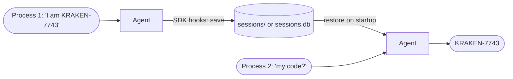

# 09 · Persistent session agent

Mnemo is a single-agent assistant with no tools whose conversation **survives a process restart**.
You tell it a fact in one run, close the program, and in the next run it remembers it. It shows how
Strands saves and restores the history without any `save()` or `load()`, and how to switch the
store (JSON on disk or a custom SQLite) without touching the agent.

> **Difference with `08`:** back to a single agent, and the change is relative to `01`: the same
> `Agent(...)` plus one parameter, `session_manager=`.

## How it works



| | |
|---|---|
| Pattern | Single agent with state persisted across processes |
| Strands pieces | `session_manager=`, `FileSessionManager`, `RepositorySessionManager`, `SessionRepository` |
| Tools | None |
| Code files | `agent.py` + `sqlite_session.py` (custom SQLite backend, standard library only) |
| Model | `gpt-5.4-mini` (overridable with `MODEL_ID`) |

**Key ideas**

- **There is no `save()` or `load()`.** The `SessionManager` hooks into the agent's events: it
  restores when the agent is built and saves each message as it is added. Restoring does not call
  the model.
- **The store is pluggable.** `sqlite_session.py` implements the nine methods of
  `SessionRepository`, just like `FileSessionManager`. `agent.py` does not know which one it got.
- **The `session_id` is the memory's key.** Two different ids are two different memories, and the
  same id in another store is **another** conversation.
- **Messages are saved, not code.** The `system_prompt`, the tools and the model always come from
  the file. The conversation is stored in plain text: `sessions/` and `*.db` are in `.gitignore`.

## Setup and running

Requirements: Python 3.10+ and an `OPENAI_API_KEY`. Same dependencies as `08` (`sqlite3` ships with
Python).

```bash
cd strands-agents/09-persistent-session-agent
python -m venv .venv && .venv/bin/pip install -r requirements.txt
cp .env.example .env                          # put your OPENAI_API_KEY in it
.venv/bin/python agent.py ana                 # session 'ana' in JSON; 'exit' to quit
.venv/bin/python agent.py ana --sqlite        # the same session, but in SQLite
.venv/bin/python agent.py ana --no-session    # no memory, like 01-08
```

| Variable / argument | Required | Use |
|---|---|---|
| `OPENAI_API_KEY` | Yes | Your OpenAI key |
| `MODEL_ID` | No | Model to use; defaults to `gpt-5.4-mini` |
| `session_id` (argument) | No | Name of the memory; defaults to `default` |
| `--sqlite` / `--no-session` | No | Switches the store or removes it |

> **The response comes out twice.** `09` keeps the default `callback_handler`, which prints it as it
> arrives; the loop prints it again after `Mnemo >`. To start from scratch:
> `rm -rf sessions sessions.db`.

## Examples

| Run | `restored messages` | Answer to "what is my member code?" |
|---|---|---|
| `ana` (after telling it the code) | 2 | `KRAKEN-7743` |
| `bruno` | 0 | "I don't know" |
| `ana --no-session` | 0 | "I don't know" |
| `ana --sqlite` | 0 | "I don't know" (another store, another memory) |

Real excerpt against `gpt-5.4-mini`, two processes in a row (the prompts were typed in Spanish and
Mnemo answered in Spanish; both are translated here):

```text
Session 'ana' | store: FileSessionManager | restored messages: 0
You > my member code is KRAKEN-7743
Mnemo > Got it. Your member code is **KRAKEN-7743**.
You > exit

Session 'ana' | store: FileSessionManager | restored messages: 2
You > what is my member code?
Mnemo > Your member code is **KRAKEN-7743**.
```

**The proof:** `restored messages: 2` is printed before the model speaks (it comes from
`len(agent.messages)`). `KRAKEN-7743` cannot be guessed, and with `bruno` the agent does not know
it.

## References

- [Session management in Strands](https://strandsagents.com/latest/documentation/docs/user-guide/concepts/agents/session-management/)
- [Hooks in Strands](https://strandsagents.com/latest/documentation/docs/user-guide/concepts/agents/hooks/) (the mechanism through which persistence plugs in)
- [OpenAI provider in Strands](https://strandsagents.com/latest/documentation/docs/user-guide/concepts/model-providers/openai/)
- Files: [`agent.py`](./agent.py) · [`sqlite_session.py`](./sqlite_session.py) · [`requirements.txt`](./requirements.txt) · [`.env.example`](./.env.example)
