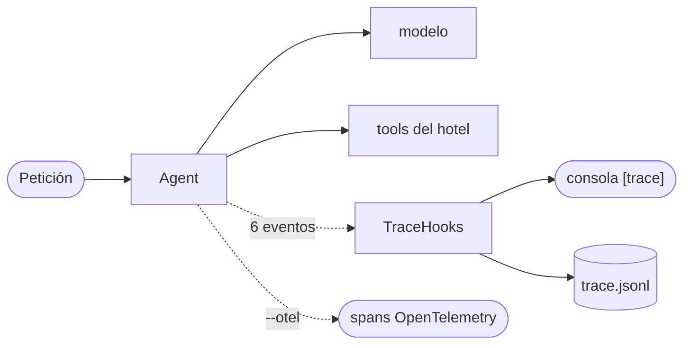

# 10 · Agente observable

Concierge es un asistente de reservas de hotel con tres herramientas (`check_availability`,
`book_room`, `cancel_booking`) que **deja un rastro de todo lo que pasa en cada turno**: qué tool
llamó, con qué datos, cuánto tardó y cuántos tokens gastó. El rastro sale de un observador externo
(`observability.py`) que el agente no conoce. Con `--otel`, además exporta las trazas
OpenTelemetry que Strands ya emitía.

> **Diferencia con `09`:** en lugar de guardar la conversación, se registra lo que ocurre durante el
> turno. El `Agent(...)` de `01` más un parámetro: `hooks=[TraceHooks(...)]`.

## Cómo funciona



| | |
|---|---|
| Patrón | Agente único con observabilidad externa |
| Piezas de Strands | `HookProvider`, `HookRegistry.add_callback`, eventos `Before/After*Event`, `StrandsTelemetry` |
| Herramientas | 3: `check_availability`, `book_room`, `cancel_booking` |
| Archivos de código | `agent.py` + `observability.py` |
| Modelo | `gpt-5.4-mini` (cambiable con `MODEL_ID`) |

**Ideas clave**

- **El observador no toca al agente.** No hay ni un `print` dentro de las tools. Quitar
  `hooks=[...]` deja el agente igual y sin rastro.
- **Seis eventos bastan:** inicio y fin del turno, de cada llamada al modelo y de cada tool.
  Responden a qué se llamó, cuánto costó y cómo terminó el turno.
- **`status="success"` no es éxito de negocio.** Una tool que devuelve `"Unknown booking code"`
  sale como `success`: el SDK solo mide si la función lanzó. Hay que leer el `result`.
- **Las métricas del SDK son acumuladas.** `TraceHooks` resta el turno anterior para mostrar el
  coste de cada turno. OpenTelemetry ya corría desde `01`; `--otel` solo le pone un exportador.

## Configuración y ejecución

Requisitos: Python 3.10+ y una `OPENAI_API_KEY`. Mismas dependencias que `09`
(`opentelemetry-sdk` ya viene con `strands-agents`).

```bash
cd strands-agents/10-observable-agent
python -m venv .venv && .venv/bin/pip install -r requirements.txt
cp .env.example .env              # pon tu OPENAI_API_KEY
.venv/bin/python agent.py         # rastro en consola + trace.jsonl; 'exit' para salir
.venv/bin/python agent.py --otel  # además, los spans OpenTelemetry por consola
```

| Variable | Obligatoria | Uso |
|---|---|---|
| `OPENAI_API_KEY` | Sí | Tu clave de OpenAI |
| `MODEL_ID` | No | Modelo a usar; por defecto `gpt-5.4-mini` |

> **`trace.jsonl` guarda prompts y resultados en claro** (y `--otel` imprime la conversación
> entera). Está en `.gitignore`; bórralo con `rm -f trace.jsonl`.

## Ejemplos

| Pides | Tool llamada | Resultado |
|---|---|---|
| "¿hay sitio el 4 de octubre?" | `check_availability` | `7 rooms free on 2026-10-04.` |
| "cancela la reserva ZZZ-0000" | `cancel_booking` | `Unknown booking code` (con `status="success"`) |
| "¿qué eres?" | Ninguna | `cycles=1 tools=0` |

Fragmento real contra `gpt-5.4-nano`:

```text
You > hay sitio el 4 de octubre?
[trace] 001 turn=1 before_invocation  prompt="hay sitio el 4 de octubre?"
[trace] 002 turn=1 before_model_call  messages=1
[trace] 003 turn=1 after_model_call   stop_reason="tool_use"
[trace] 004 turn=1 before_tool_call   tool="check_availability"  input={"date": "2026-10-04"}
[trace] 005 turn=1 after_tool_call    tool="check_availability"  status="success"  duration_ms=0.34
                                      result="7 rooms free on 2026-10-04."
[trace] 006 turn=1 before_model_call  messages=3
[trace] 007 turn=1 after_model_call   stop_reason="end_turn"
[trace] 008 turn=1 after_invocation   cycles=2  tools=1  tokens=624

Concierge > Sí, hay sitio el **4 de octubre de 2026** (quedan **7 habitaciones libres**).
```

**La prueba:** cada línea `[trace]` la escribe el hook desde un evento del SDK, y la misma línea
queda como JSON en `trace.jsonl` (`jq . trace.jsonl`). Las `7` habitaciones solo existen en un
`dict` de `agent.py`.

## Referencias

- [Hooks en Strands](https://strandsagents.com/latest/documentation/docs/user-guide/concepts/agents/hooks/)
- [Observabilidad en Strands](https://strandsagents.com/latest/documentation/docs/user-guide/observability/)
- [Proveedor OpenAI en Strands](https://strandsagents.com/latest/documentation/docs/user-guide/concepts/model-providers/openai/)
- Archivos: [`agent.py`](./agent.py) · [`observability.py`](./observability.py) · [`requirements.txt`](./requirements.txt) · [`.env.example`](./.env.example)
