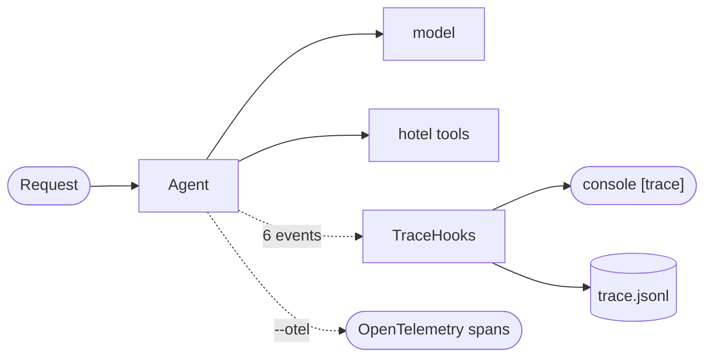

# 10 · Observable agent

Concierge is a hotel-booking assistant with three tools (`check_availability`, `book_room`,
`cancel_booking`) that **leaves a trail of everything that happens in each turn**: which tool it
called, with what data, how long it took and how many tokens it spent. The trail comes from an
external observer (`observability.py`) that the agent knows nothing about. With `--otel`, it also
exports the OpenTelemetry traces that Strands was already emitting.

> **Difference with `09`:** instead of saving the conversation, it records what happens during the
> turn. The `Agent(...)` from `01` plus one parameter: `hooks=[TraceHooks(...)]`.

## How it works



| | |
|---|---|
| Pattern | Single agent with external observability |
| Strands pieces | `HookProvider`, `HookRegistry.add_callback`, `Before/After*Event` events, `StrandsTelemetry` |
| Tools | 3: `check_availability`, `book_room`, `cancel_booking` |
| Code files | `agent.py` + `observability.py` |
| Model | `gpt-5.4-mini` (overridable with `MODEL_ID`) |

**Key ideas**

- **The observer does not touch the agent.** There is not a single `print` inside the tools.
  Removing `hooks=[...]` leaves the agent the same and with no trail.
- **Six events are enough:** start and end of the turn, of each model call and of each tool. They
  answer what was called, what it cost and how the turn ended.
- **`status="success"` is not business success.** A tool that returns `"Unknown booking code"`
  comes out as `success`: the SDK only measures whether the function raised. You have to read the
  `result`.
- **The SDK's metrics are cumulative.** `TraceHooks` subtracts the previous turn to show each
  turn's cost. OpenTelemetry has been running since `01`; `--otel` only adds an exporter to it.

## Setup and running

Requirements: Python 3.10+ and an `OPENAI_API_KEY`. Same dependencies as `09`
(`opentelemetry-sdk` already comes with `strands-agents`).

```bash
cd strands-agents/10-observable-agent
python -m venv .venv && .venv/bin/pip install -r requirements.txt
cp .env.example .env              # put your OPENAI_API_KEY in it
.venv/bin/python agent.py         # trail on the console + trace.jsonl; 'exit' to quit
.venv/bin/python agent.py --otel  # plus the OpenTelemetry spans on the console
```

| Variable | Required | Use |
|---|---|---|
| `OPENAI_API_KEY` | Yes | Your OpenAI key |
| `MODEL_ID` | No | Model to use; defaults to `gpt-5.4-mini` |

> **`trace.jsonl` stores prompts and results in plain text** (and `--otel` prints the whole
> conversation). It is in `.gitignore`; delete it with `rm -f trace.jsonl`.

## Examples

| You ask | Tool called | Result |
|---|---|---|
| "is there room on October 4?" | `check_availability` | `7 rooms free on 2026-10-04.` |
| "cancel booking ZZZ-0000" | `cancel_booking` | `Unknown booking code` (with `status="success"`) |
| "what are you?" | None | `cycles=1 tools=0` |

Real excerpt against `gpt-5.4-nano` (the prompt was typed in Spanish and the answer was in
Spanish; both are translated here):

```text
You > is there room on October 4?
[trace] 001 turn=1 before_invocation  prompt="is there room on October 4?"
[trace] 002 turn=1 before_model_call  messages=1
[trace] 003 turn=1 after_model_call   stop_reason="tool_use"
[trace] 004 turn=1 before_tool_call   tool="check_availability"  input={"date": "2026-10-04"}
[trace] 005 turn=1 after_tool_call    tool="check_availability"  status="success"  duration_ms=0.34
                                      result="7 rooms free on 2026-10-04."
[trace] 006 turn=1 before_model_call  messages=3
[trace] 007 turn=1 after_model_call   stop_reason="end_turn"
[trace] 008 turn=1 after_invocation   cycles=2  tools=1  tokens=624

Concierge > Yes, there is room on **October 4, 2026** (**7 rooms left**).
```

**The proof:** each `[trace]` line is written by the hook from an SDK event, and the same line is
stored as JSON in `trace.jsonl` (`jq . trace.jsonl`). The `7` rooms only exist in a `dict` in
`agent.py`.

## References

- [Hooks in Strands](https://strandsagents.com/latest/documentation/docs/user-guide/concepts/agents/hooks/)
- [Observability in Strands](https://strandsagents.com/latest/documentation/docs/user-guide/observability/)
- [OpenAI provider in Strands](https://strandsagents.com/latest/documentation/docs/user-guide/concepts/model-providers/openai/)
- Files: [`agent.py`](./agent.py) · [`observability.py`](./observability.py) · [`requirements.txt`](./requirements.txt) · [`.env.example`](./.env.example)
