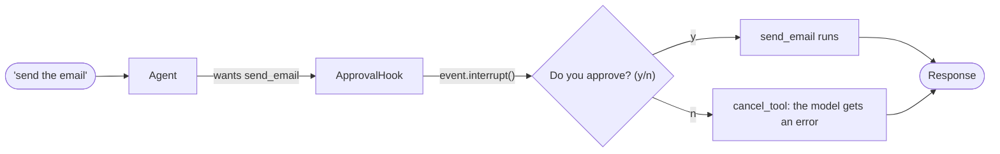

# 11 · Human-in-the-loop

Mailbot is an email assistant with two tools: `draft_email` (harmless) and `send_email`
(sensitive). Before sending anything, the agent **pauses and asks for approval in the terminal**.
If you answer `y`, the email is sent; with anything else, the tool never runs. All the approval
logic lives in `approval.py`: `send_email` does not know it is being watched.

> **Difference with `10`:** the hook no longer just watches, it decides. A single subscription
> (`BeforeToolCallEvent`) that can pause the turn or cancel the tool.

## How it works



| | |
|---|---|
| Pattern | Single agent with human approval before a sensitive action |
| Strands pieces | `BeforeToolCallEvent`, `event.interrupt()`, `event.cancel_tool`, `result.interrupts`, `interruptResponse` |
| Tools | 2: `draft_email` (never pauses), `send_email` (always pauses) |
| Code files | `agent.py` + `approval.py` (20 lines) |
| Model | `gpt-5.4-mini` (overridable with `MODEL_ID`) |

**Key ideas**

- **Pausing is not an exception you have to catch.** `agent(...)` returns a result with
  `stop_reason == "interrupt"` and the list of pending `interrupts`.
- **Resuming is not a new prompt.** You call `agent(...)` with a list of
  `{"interruptResponse": {"interruptId": ..., "response": "y"}}` and the same turn continues.
- **Denying is an error like any other.** `cancel_tool` makes the model receive
  `"User denied permission to send the email"` with `status: "error"`, and it explains this to the
  user.
- **On resume, the hook runs in full again.** That is why the check before `interrupt()` must be
  cheap and free of side effects.

## Setup and running

Requirements: Python 3.10+ and an `OPENAI_API_KEY`. Same dependencies as `10`.

```bash
cd strands-agents/11-human-in-the-loop
python -m venv .venv && .venv/bin/pip install -r requirements.txt
cp .env.example .env          # put your OPENAI_API_KEY in it
.venv/bin/python agent.py     # 'exit' to quit
```

| Variable | Required | Use |
|---|---|---|
| `OPENAI_API_KEY` | Yes | Your OpenAI key |
| `MODEL_ID` | No | Model to use; defaults to `gpt-5.4-mini` |

> **`callback_handler=None` is necessary here.** Without it, the model's text gets mixed with the
> approval question and you would approve without properly reading what is about to be sent.

## Examples

| You ask | Pauses? | Result |
|---|---|---|
| "draft (without sending) an email to ana@example.com" | No | Only `draft_email` |
| "send the draft to boss@example.com" + you answer `n` | Yes | Nothing is sent |
| "send the draft to boss@example.com" + you answer `y` | Yes | Sent, `MSG-4471` |

Real excerpt against `gpt-5.4-nano` (send and approve; the prompt was typed in Spanish and the
answer was in Spanish, both translated here):

```text
You > I already have the draft ready for boss@example.com (subject: Reporte Q3, body: "See attached."). Send it now, don't ask for more confirmation.

[approval] mailer-approval
  to: boss@example.com
  subject: Reporte Q3
  body: See attached.
  Approve sending? (y/n): y

Mailbot > Done—I sent the email to **boss@example.com** (Subject: **"Reporte Q3"**).
Message ID: **MSG-4471**.
```

**The proof:** `MSG-4471` comes from an iterator in `agent.py` only if `send_email` really ran.
Answering `n`, the `SENT` list stays empty. In this run the model requested two sends at once and
the CLI asked for one approval for each (one is shown here).

## References

- [Hooks in Strands](https://strandsagents.com/latest/documentation/docs/user-guide/concepts/agents/hooks/) (`BeforeToolCallEvent` and its writable fields)
- [OpenAI provider in Strands](https://strandsagents.com/latest/documentation/docs/user-guide/concepts/model-providers/openai/)
- Files: [`agent.py`](./agent.py) · [`approval.py`](./approval.py) · [`requirements.txt`](./requirements.txt) · [`.env.example`](./.env.example)
