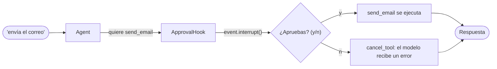

# 11 · Human-in-the-loop

Mailbot es un asistente de correo con dos herramientas: `draft_email` (inofensiva) y `send_email`
(sensible). Antes de enviar nada, el agente **se pausa y pide aprobación en la terminal**. Si
respondes `y`, el correo se envía; con cualquier otra cosa, la tool nunca se ejecuta. Toda la
lógica de aprobación vive en `approval.py`: `send_email` no sabe que la vigilan.

> **Diferencia con `10`:** el hook ya no solo mira, decide. Una sola suscripción
> (`BeforeToolCallEvent`) que puede pausar el turno o cancelar la tool.

## Cómo funciona



| | |
|---|---|
| Patrón | Agente único con aprobación humana antes de una acción sensible |
| Piezas de Strands | `BeforeToolCallEvent`, `event.interrupt()`, `event.cancel_tool`, `result.interrupts`, `interruptResponse` |
| Herramientas | 2: `draft_email` (nunca pausa), `send_email` (siempre pausa) |
| Archivos de código | `agent.py` + `approval.py` (20 líneas) |
| Modelo | `gpt-5.4-mini` (cambiable con `MODEL_ID`) |

**Ideas clave**

- **Pausar no es una excepción que tengas que capturar.** `agent(...)` devuelve un resultado con
  `stop_reason == "interrupt"` y la lista de `interrupts` pendientes.
- **Reanudar no es un prompt nuevo.** Se llama a `agent(...)` con una lista de
  `{"interruptResponse": {"interruptId": ..., "response": "y"}}` y continúa el mismo turno.
- **Denegar es un error como cualquier otro.** `cancel_tool` hace que el modelo reciba
  `"User denied permission to send the email"` con `status: "error"`, y lo explica al usuario.
- **Al reanudar, el hook se ejecuta entero otra vez.** Por eso la comprobación previa a
  `interrupt()` debe ser barata y sin efectos secundarios.

## Configuración y ejecución

Requisitos: Python 3.10+ y una `OPENAI_API_KEY`. Mismas dependencias que `10`.

```bash
cd strands-agents/11-human-in-the-loop
python -m venv .venv && .venv/bin/pip install -r requirements.txt
cp .env.example .env          # pon tu OPENAI_API_KEY
.venv/bin/python agent.py     # 'exit' para salir
```

| Variable | Obligatoria | Uso |
|---|---|---|
| `OPENAI_API_KEY` | Sí | Tu clave de OpenAI |
| `MODEL_ID` | No | Modelo a usar; por defecto `gpt-5.4-mini` |

> **`callback_handler=None` es necesario aquí.** Sin él, el texto del modelo se mezcla con la
> pregunta de aprobación y aprobarías sin leer bien qué se va a enviar.

## Ejemplos

| Pides | ¿Pausa? | Resultado |
|---|---|---|
| "redacta (sin enviar) un correo para ana@example.com" | No | Solo `draft_email` |
| "envía el borrador a boss@example.com" + respondes `n` | Sí | No se envía nada |
| "envía el borrador a boss@example.com" + respondes `y` | Sí | Enviado, `MSG-4471` |

Fragmento real contra `gpt-5.4-nano` (enviar y aprobar):

```text
You > ya tengo el borrador listo para boss@example.com (asunto: Reporte Q3, cuerpo: "See attached."). Envialo ahora, no pidas mas confirmacion.

[approval] mailer-approval
  to: boss@example.com
  subject: Reporte Q3
  body: See attached.
  Approve sending? (y/n): y

Mailbot > Listo—envié el correo a **boss@example.com** (Asunto: **"Reporte Q3"**).
ID del mensaje: **MSG-4471**.
```

**La prueba:** `MSG-4471` sale de un iterador de `agent.py` solo si `send_email` corrió de verdad.
Respondiendo `n`, la lista `SENT` queda vacía. En esta corrida el modelo pidió dos envíos a la vez y
la CLI pidió una aprobación por cada uno (aquí se muestra una).

## Referencias

- [Hooks en Strands](https://strandsagents.com/latest/documentation/docs/user-guide/concepts/agents/hooks/) (`BeforeToolCallEvent` y sus campos escribibles)
- [Proveedor OpenAI en Strands](https://strandsagents.com/latest/documentation/docs/user-guide/concepts/model-providers/openai/)
- Archivos: [`agent.py`](./agent.py) · [`approval.py`](./approval.py) · [`requirements.txt`](./requirements.txt) · [`.env.example`](./.env.example)
