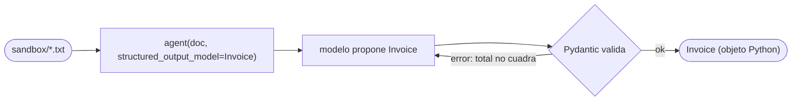

# 12 · Salida estructurada

Ledger es un extractor de facturas de un solo agente, sin herramientas: lee un documento de texto
de `sandbox/` y devuelve un objeto `Invoice` de Pydantic ya validado, no texto. El esquema incluye
una regla que ningún tipo puede expresar solo: **el total tiene que cuadrar con la suma de las
líneas**. Si no cuadra, el modelo recibe el error y se corrige dentro de la misma llamada.

> **Diferencia con `11`:** vuelve el agente sin tools, y la salida estructurada de `05` pasa de
> ser un medio (despachar) a ser el resultado, con un esquema que sí puede fallar.

## Cómo funciona



| | |
|---|---|
| Patrón | Agente único con salida estructurada y autocorrección |
| Piezas de Strands | `structured_output_model=`, `result.structured_output` |
| Herramientas | Ninguna escrita a mano |
| Modelo | `gpt-5.4-mini` (cambiable con `MODEL_ID`) |

**Ideas clave**

- **El reintento lo hace el SDK.** Si Pydantic rechaza el objeto, el error vuelve al modelo y este
  lo corrige. En `agent.py` no hay `try/except`, ni contador, ni parsing.
- **Las restricciones simples viajan al modelo; el validador no.** `ge=1` o `min_length=1` van en
  el JSON Schema. Del `@model_validator` solo llega su mensaje de error, por eso está escrito como
  instrucción: *"Re-read the document..."*.
- **El modelo convierte los tipos.** `4 March 2026` pasa a `date` y `$` pasa a `"USD"`: lo hace el
  LLM, no Pydantic.
- **Un esquema garantiza forma, no verdad.** Si el modelo lee mal dos importes de forma
  coherente, el total puede seguir cuadrando.

## Configuración y ejecución

Requisitos: Python 3.10+ y una `OPENAI_API_KEY`. Mismas dependencias que `11` (Pydantic ya viene
con `strands-agents`).

```bash
cd strands-agents/12-structured-output
python -m venv .venv && .venv/bin/pip install -r requirements.txt
cp .env.example .env          # pon tu OPENAI_API_KEY
.venv/bin/python agent.py     # escribe el nombre de un archivo de sandbox/; 'exit' para salir
```

| Variable | Obligatoria | Uso |
|---|---|---|
| `OPENAI_API_KEY` | Sí | Tu clave de OpenAI |
| `MODEL_ID` | No | Modelo a usar; por defecto `gpt-5.4-mini` |

> **En una extracción correcta, `stop_reason` es `"tool_use"`, no `"end_turn"`.** El SDK corta el
> bucle en cuanto el objeto valida.

## Ejemplos

| Archivo | Qué tiene de particular | Qué demuestra |
|---|---|---|
| `clean.txt` | Todo impreso, fecha ISO | El caso normal |
| `shipping.txt` | Envío impreso fuera de la tabla, incluido en el total | La regla `total == Σ items` |
| `messy.txt` | Fecha en texto (`4 March 2026`), moneda como `$` | Conversión de tipos |

Fragmento real contra `gpt-5.4-nano`:

```text
Invoice > shipping.txt

[ok] INV-8843 · Nordkapp Rigging AB · 2026-03-11 · EUR
     3 x Deck cleat               @   100.00
     1 x Shipping fee             @    15.00
     total: 315.00  (date)

Invoice > messy.txt

[ok] INV-8844 · Nordkapp Rigging AB · 2026-03-04 · USD
     4 x Winch handle             @    25.00
     1 x Anchor chain 10m         @    80.00
     total: 180.00  (date)
```

**La prueba:** `(date)` es `type(invoice.issued_on).__name__`: el resultado es un objeto Python, no
texto. En esta corrida real el modelo incluyó el envío a la primera y el validador no llegó a
saltar; el ciclo de error y corrección se verificó con un modelo simulado, con los mismos números
(`total is 315.0 but the 1 items add up to 300.0`).

## Referencias

- [Salida estructurada en Strands](https://strandsagents.com/latest/documentation/docs/user-guide/concepts/agents/structured-output/)
- [Pydantic: validadores](https://docs.pydantic.dev/latest/concepts/validators/)
- [Proveedor OpenAI en Strands](https://strandsagents.com/latest/documentation/docs/user-guide/concepts/model-providers/openai/)
- Archivos: [`agent.py`](./agent.py) · [`sandbox/`](./sandbox/) · [`requirements.txt`](./requirements.txt) · [`.env.example`](./.env.example)
