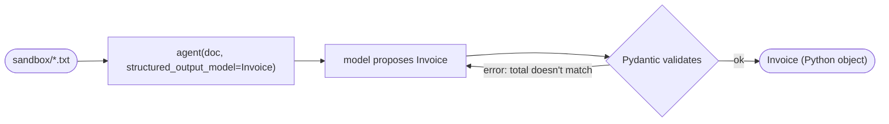

# 12 · Structured output

Ledger is a single-agent invoice extractor with no tools: it reads a text document from `sandbox/`
and returns an already validated Pydantic `Invoice` object, not text. The schema includes a rule
that no type can express on its own: **the total has to match the sum of the lines**. If it does
not, the model receives the error and corrects itself within the same call.

> **Difference with `11`:** the agent with no tools is back, and the structured output from `05`
> goes from being a means (dispatching) to being the result, with a schema that can actually fail.

## How it works



| | |
|---|---|
| Pattern | Single agent with structured output and self-correction |
| Strands pieces | `structured_output_model=`, `result.structured_output` |
| Tools | None written by hand |
| Model | `gpt-6-luna` (overridable with `MODEL_ID`) |

**Key ideas**

- **The SDK does the retry.** If Pydantic rejects the object, the error goes back to the model and
  it fixes it. In `agent.py` there is no `try/except`, no counter, no parsing.
- **Simple constraints travel to the model; the validator does not.** `ge=1` or `min_length=1` go
  into the JSON Schema. From the `@model_validator` only its error message arrives, which is why it
  is written as an instruction: *"Re-read the document..."*.
- **The model converts the types.** `4 March 2026` becomes a `date` and `$` becomes `"USD"`: the
  LLM does this, not Pydantic.
- **A schema guarantees shape, not truth.** If the model misreads two amounts consistently, the
  total can still add up.

## Setup and running

Requirements: Python 3.10+ and an `OPENAI_API_KEY`. Same dependencies as `11` (Pydantic already
comes with `strands-agents`).

```bash
cd strands-agents/12-structured-output
python -m venv .venv && .venv/bin/pip install -r requirements.txt
cp .env.example .env          # put your OPENAI_API_KEY in it
.venv/bin/python agent.py     # type the name of a file in sandbox/; 'exit' to quit
```

| Variable | Required | Use |
|---|---|---|
| `OPENAI_API_KEY` | Yes | Your OpenAI key |
| `MODEL_ID` | No | Model to use; defaults to `gpt-6-luna` |

> **In a successful extraction, `stop_reason` is `"tool_use"`, not `"end_turn"`.** The SDK cuts the
> loop as soon as the object validates.

## Examples

| File | What is special about it | What it demonstrates |
|---|---|---|
| `clean.txt` | Everything printed, ISO date | The normal case |
| `shipping.txt` | Shipping printed outside the table, included in the total | The `total == Σ items` rule |
| `messy.txt` | Date as text (`4 March 2026`), currency as `$` | Type conversion |

Real excerpt against `gpt-5.4-nano`:

```text
Invoice > shipping.txt

[ok] INV-8843 · Nordkapp Rigging AB · 2026-03-11 · EUR
     3 x Deck cleat               @   100.00
     1 x Shipping fee             @    15.00
     total: 315.00  (date)

Invoice > messy.txt

[ok] INV-8844 · Nordkapp Rigging AB · 2026-03-04 · USD
     4 x Winch handle             @    25.00
     1 x Anchor chain 10m         @    80.00
     total: 180.00  (date)
```

**The proof:** `(date)` is `type(invoice.issued_on).__name__`: the result is a Python object, not
text. In this real run the model included the shipping on the first try and the validator never
fired; the error-and-correction cycle was verified with a simulated model, with the same numbers
(`total is 315.0 but the 1 items add up to 300.0`).

## References

- [Structured output in Strands](https://strandsagents.com/latest/documentation/docs/user-guide/concepts/agents/structured-output/)
- [Pydantic: validators](https://docs.pydantic.dev/latest/concepts/validators/)
- [OpenAI provider in Strands](https://strandsagents.com/latest/documentation/docs/user-guide/concepts/model-providers/openai/)
- Files: [`agent.py`](./agent.py) · [`sandbox/`](./sandbox/) · [`requirements.txt`](./requirements.txt) · [`.env.example`](./.env.example)
